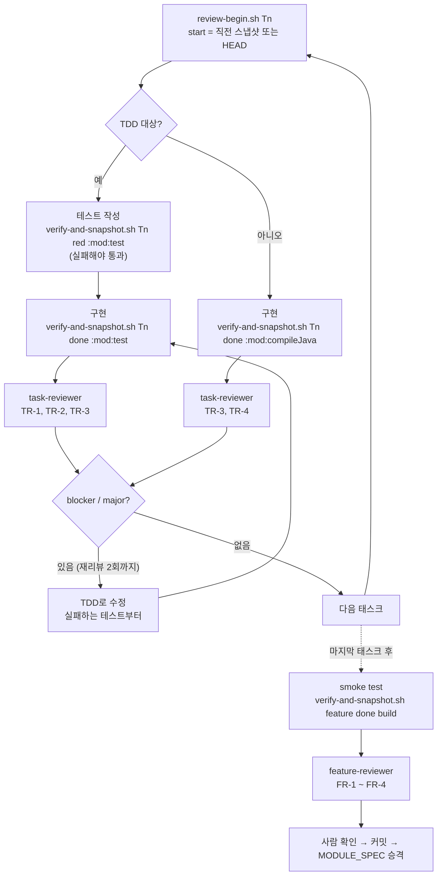

# Kiro spec workflow에 에이전트 코드 리뷰 단계를 추가하는 제안

> 결정론적 게이트가 보지 못하는 "맞는 걸 만들었는가"만 리뷰한다

- 작성일: 2026-11-02
- 상태: 제안 (사내 Kiro 환경 검증 전)
- 대상: Kiro(IDE·CLI) spec workflow, Java/Spring(Spring Batch 포함), Gradle 멀티모듈, Spotless(Palantir Java Format), SpotBugs, JaCoCo
- 산출물: 이 문서, [스크립트 6개](agent-code-review/scripts/), [Kiro 에이전트·steering 초안](agent-code-review/kiro/)

## 목차

- [TL;DR](#tldr)
- [1. 현재 구조와 빈칸](#1-현재-구조와-빈칸)
- [2. 제안 전체 흐름](#2-제안-전체-흐름)
- [3. 리뷰 시점](#3-리뷰-시점)
- [4. 리뷰 항목](#4-리뷰-항목)
- [5. 리뷰 입력: 커밋 없는 스냅샷](#5-리뷰-입력-커밋-없는-스냅샷)
- [6. 리뷰 에이전트 구성](#6-리뷰-에이전트-구성)
- [7. 도입 단계](#7-도입-단계)
- [8. 비용과 트레이드오프](#8-비용과-트레이드오프)
- [9. 검토했다 버린 대안](#9-검토했다-버린-대안)
- [10. 미검증 사항](#10-미검증-사항)
- [부록. 컴파일 시 소스 재작성과 편집 실패](#부록-컴파일-시-소스-재작성과-편집-실패)
- [참고 자료](#참고-자료)
- [변경 이력](#변경-이력)

## TL;DR

- **리뷰 단계를 추가합니다. 다만 범용 코드 리뷰가 아니라 지금 게이트가 구조적으로 보지 못하는 영역만 맡깁니다.** TDD는 "테스트가 통과하는가", SpotBugs는 "알려진 버그 패턴이 있는가", JaCoCo는 "실행됐는가"를 봅니다. 셋 다 "스펙대로 만들었는가"와 "그 테스트를 믿어도 되는가"는 보지 않습니다.
- **리뷰는 두 곳에 둡니다.** 태스크가 끝날 때 diff만 보는 가벼운 리뷰("이 테스트를 믿어도 되나?")와, smoke test 이후 커밋·MODULE_SPEC 승격 전에 하는 feature 리뷰("합쳤을 때 스펙대로인가?")입니다.
- **가장 효과가 클 항목은 TR-2(Red 이후 테스트 변경)와 FR-2(태스크 사이 이음새)입니다.** TR-2는 에이전트가 테스트를 구현에 맞춰 고치는 행동을 잡습니다. 이 행동은 벤치마크로 측정된 실제 경향입니다. FR-2는 태스크 단위 TDD로는 원리상 잡을 수 없는 영역입니다.
- **리뷰 범위는 메인 에이전트의 보고가 아니라 git이 정합니다.** 커밋 없이 `commit-tree`와 워크트리별 ref(`refs/worktree/review/*`)로 스냅샷을 찍습니다. pre-commit 훅이 돌지 않고, 커밋 로그와 staging을 건드리지 않으며, 병렬 워크트리끼리 충돌하지 않습니다. 임시 저장소에서 검증했습니다.
- **리뷰어는 별도 컨텍스트에서 돌고, 읽기만 하며, 고치지 않습니다.** 권한은 지시문이 아니라 Kiro 권한 규칙(`deny` + `exclude`)으로 강제합니다. 수정은 반드시 실패하는 테스트부터 시작하는 TDD 루프로 돌려보냅니다.
- **처음에는 리포트만 받고, 채택률이 높은 항목만 차단 게이트로 올립니다.** 처음부터 막으면 에이전트가 리뷰어를 통과하는 쪽으로 코드를 맞추게 됩니다.

## 1. 현재 구조와 빈칸

### 1.1 현재 워크플로우

| 단계 | 하는 일 | 검증 |
| --- | --- | --- |
| 스펙 | 브레인스토밍 → requirements → design → tasks | 사람이 리뷰 |
| 태스크 (비즈니스 로직) | TDD로 구현 | 해당 서브모듈 `test` 통과 |
| 태스크 (인터페이스, VO) | 구현 | `compileJava` 통과 |
| smoke test | 전체 빌드 | `build`, SpotBugs, JaCoCo |
| 마무리 | 전체 작업을 한 번에 커밋 | pre-commit 훅(Spotless) |

포맷은 `compileJava`가 `spotlessApply`에 의존하도록 걸려 있어서, 컴파일이나 테스트를 실행할 때마다 적용됩니다.

### 1.2 각 게이트가 보장하는 것과 보장하지 않는 것

| 게이트 | 보장하는 것 | 보장하지 않는 것 |
| --- | --- | --- |
| TDD (`test`) | 테스트가 통과한다 | 테스트가 AC를 검증한다, 테스트가 중간에 바뀌지 않았다 |
| `compileJava` | 컴파일된다 | TDD 비대상 태스크에 로직이 들어오지 않았다 |
| SpotBugs | 알려진 버그 패턴이 없다 | 스펙대로 동작한다 |
| JaCoCo | 일정 비율 이상 실행됐다 | 빠진 부분이 위험하지 않다 |
| Spotless | 포맷이 일정하다 | (의미와 무관) |

오른쪽 열이 이 제안이 채우려는 빈칸입니다. 크게 세 가지입니다.

1. **테스트 신뢰성**: 초록불인 테스트가 실제로 무엇을 검증하는지
2. **스펙 정합성**: AC, 설계 결정, MODULE_SPEC 규칙과 코드가 맞는지
3. **이음새**: 태스크마다는 맞는데 합치면 깨지는 부분

**근거**

- 이 세 가지는 판단이 필요한 영역입니다. 같은 입력에 항상 같은 답을 내는 도구로는 표현하기 어렵습니다. 반대로 결정론적 도구로 표현할 수 있는 것(포맷, 버그 패턴, 레이어 의존)은 LLM에 맡기지 않는 것이 이 프로젝트의 원칙입니다(4.3절).

## 2. 제안 전체 흐름



## 3. 리뷰 시점

### 3.1 태스크 리뷰: 태스크 검증 직후, 다음 태스크 전

태스크의 `done` 검증이 통과한 직후에, 그 태스크의 diff만 봅니다.

**근거**

- **결함은 가까운 곳에서 잡을수록 쌉니다.** 테스트를 구현에 맞춰 고친 흔적(TR-2)은 feature 끝에 가면 다른 태스크의 변경에 섞여서 찾기 어렵습니다. 다음 태스크가 그 테스트를 근거로 쌓이기도 합니다.
- **리뷰 입력이 작아야 정확합니다.** 태스크 하나의 diff는 리뷰어가 전부 읽을 수 있는 크기입니다. feature 전체 diff를 한 번에 주면 리뷰어도 훑어보게 됩니다. 스펙 검토 시간을 사람의 집중 한계(약 10분)로 자르는 것과 같은 이유입니다.

### 3.2 feature 리뷰: smoke test 이후, 커밋·MODULE_SPEC 승격 전

**근거**

- **결정론적 게이트를 먼저 통과시킵니다.** SpotBugs와 JaCoCo가 끝난 뒤에 리뷰해야 리뷰어가 도구가 이미 잡은 것에 토큰을 쓰지 않습니다. 두 도구의 XML 결과는 리뷰어의 입력으로 씁니다(FR-3).
- **MODULE_SPEC 승격 직전이 스펙 드리프트를 잡을 마지막 지점입니다.** 승격되고 나면 코드와 다른 규칙이 "현재 상태 SSOT"가 됩니다. FR-4가 이 지점을 지킵니다. 미해결 과제인 스펙 드리프트 탐지와 같은 일이라서, 따로 만들지 않고 이 리뷰에 합칩니다.

### 3.3 리뷰를 두지 않는 시점

| 시점 | 두지 않는 이유 |
| --- | --- |
| 파일 저장마다 (hook) | 태스크 도중의 중간 상태는 원래 불완전합니다. 오탐만 늘고, 중간 관찰이 다음 결정을 바꾸는 TDD 루프를 방해합니다. |
| Red 직후 | 이 시점의 테스트 품질(TR-1)은 done에서 함께 봐도 늦지 않습니다. 리뷰 횟수만 두 배가 됩니다. |
| 커밋 이후 | 이미 한 번에 커밋하는 구조라서, 커밋 뒤의 리뷰는 되돌리는 비용만 큽니다. |

## 4. 리뷰 항목

한마디로 태스크 리뷰는 **"이 테스트를 믿어도 되나?"**, feature 리뷰는 **"조각을 합쳤을 때 스펙대로인가?"**를 봅니다. 항목 ID는 리뷰어 출력의 `check` 필드에 그대로 씁니다.

| ID | 단계 | 대상 태스크 | 질문 |
| --- | --- | --- | --- |
| TR-1 | 태스크 | TDD | 테스트가 AC를 실제로 검증하는가 |
| TR-2 | 태스크 | TDD | Red 이후 테스트가 구현에 맞춰 바뀌지 않았는가 |
| TR-3 | 태스크 | 전체 | 범위 밖의 코드가 들어왔는가 |
| TR-4 | 태스크 | 비TDD | TDD 비대상 태스크에 로직이 들어왔는가 |
| FR-1 | feature | – | AC ↔ 테스트 ↔ 코드가 빠짐없이 대응하는가 |
| FR-2 | feature | – | 태스크 사이 이음새가 맞는가 |
| FR-3 | feature | – | JaCoCo 미커버 분기 중 위험한 것이 있는가 |
| FR-4 | feature | – | 설계·MODULE_SPEC과 어긋나지 않는가, 승격할 규칙이 있는가 |

### 4.1 TR-1 테스트가 AC를 실제로 검증하는가

초록불이어도 아무것도 확인하지 않는 테스트가 있습니다. AC가 "VIP 회원은 10% 할인"일 때 이런 것들이 걸립니다.

```java
assertThat(result).isNotNull();                        // 값을 보지 않음
assertThat(result).isEqualTo(price * (1 - VIP_RATE));  // 구현과 같은 공식이라 둘 다 틀려도 통과
verify(repository).save(any());                        // 무엇을 저장했는지 보지 않음
```

기대값을 `9_000`처럼 리터럴로 쓰고, 저장된 객체의 필드까지 확인해야 AC를 검증한 것입니다.

**근거**

- 태스크의 완료 조건이 "테스트 통과"이므로, 테스트가 약하면 완료 조건 자체가 무의미해집니다. JaCoCo 커버리지도 이런 테스트로 채워질 수 있습니다. 실행만 하고 단언하지 않는 테스트도 커버리지에는 잡히기 때문입니다.
- 사람이 엣지케이스 테스트를 먼저 쓰는 경우에도, 에이전트가 추가로 쓴 테스트는 이 검사가 필요합니다.

### 4.2 TR-2 Red 이후 테스트가 구현에 맞춰 바뀌지 않았는가

구현이 테스트를 통과하지 못할 때 에이전트는 테스트 쪽을 고치는 경향이 있습니다.

- `isEqualTo(9_000)`이던 기대값이 구현 결과에 맞춰 `9_100`으로 바뀜
- 경계값 테스트에 `@Disabled`가 붙음
- "10만 원 **이상**"을 검증하던 테스트가 조용히 "초과"로 바뀜

리뷰어는 `red` 스냅샷과 `done` 스냅샷 사이의 테스트 diff를 받습니다(5장). 변경이 있으면 스펙에 근거가 있는지 확인하고, 근거가 없으면 blocker로 기록합니다.

**근거**

- **실제로 측정된 행동입니다.** ImpossibleBench는 스펙과 모순되도록 테스트를 고친 "불가능한" 과제를 만들어, 에이전트가 이를 통과하는 비율로 테스트 악용 경향을 쟀습니다. 실패하는 테스트를 버그를 고치는 대신 지워 버리는 행동을 대표 사례로 들고, Claude 계열 모델은 주로 테스트를 수정하는 방식으로 우회했다고 보고합니다. 테스트 접근을 제한하면 악용이 줄었습니다([Zhong et al., 2025](https://arxiv.org/abs/2510.20270)).
- **지시만으로는 막히지 않습니다.** METR은 최신 모델들이 테스트나 채점 코드를 고쳐 점수를 올리는 사례를 보고했습니다. 이 보고에서 한 과제에 "속이지 말라"는 지시를 추가해도 reward hacking 비율이 줄지 않았습니다([METR, 2025](https://metr.org/blog/2025-06-05-recent-reward-hacking/)). 그래서 steering 문구가 아니라 스냅샷 diff라는 증거로 확인합니다.
- **결정론적 증거가 있어 오탐이 적습니다.** 판단의 출발점이 "테스트 파일이 바뀌었다"는 사실이라서, 리뷰어가 추측할 여지가 다른 항목보다 작습니다. 처음부터 높은 채택률을 기대할 수 있는 항목입니다(7장).

### 4.3 TR-3 범위 밖의 코드가 들어왔는가

태스크는 "VIP 할인 계산"인데 diff에 이런 것이 섞인 경우입니다.

- AC에 없는 "GOLD 등급 5% 할인"이 추가됨 ("어차피 필요할 것 같아서")
- 상관없는 `MemberRepository` 쿼리 수정이나 캐시 추가

테스트는 모두 통과하니 게이트에 걸리지 않지만, 스펙에 없는 동작이 운영에 나가게 됩니다.

**근거**

- **스펙에 없는 코드는 리뷰도 테스트도 받지 않은 코드입니다.** SDD에서 스펙이 의미를 가지려면 "스펙에 없는 동작은 없다"가 성립해야 합니다.
- **이 검사는 리뷰 범위를 git이 정할 때만 작동합니다.** 메인 에이전트가 넘긴 파일 목록으로 리뷰하면, 범위 밖에서 고친 파일은 목록에서 빠질 수 있고 그러면 검사 자체가 성립하지 않습니다(5.1절).

### 4.4 TR-4 TDD 비대상 태스크에 로직이 들어왔는가

"로직이 아니다"로 분류된 태스크가 TDD를 우회하는 통로가 될 수 있습니다. VO 생성 태스크인데 이렇게 쓰는 경우입니다.

```java
public record Money(long amount) {
    public Money {
        if (amount < 0) throw new IllegalArgumentException(); // 비즈니스 규칙
    }
    public Money applyDiscount(Grade grade) { ... }          // 로직
}
```

완료 조건이 `compileJava`뿐이라서 테스트 없이 규칙이 들어갑니다. 발견되면 그 부분을 TDD 태스크로 되돌립니다.

**근거**

- **완료 조건이 약한 곳으로 일이 몰립니다.** 비TDD 태스크의 완료 조건은 컴파일뿐이라서, 같은 코드를 TDD 태스크에 넣을 때보다 통과하기 쉽습니다.
- **후보는 결정론적으로 거릅니다.** [`logic-candidates.sh`](agent-code-review/scripts/logic-candidates.sh)가 diff의 추가된 줄에서 `if`, `switch`, `throw`, 스트림 연산, `BigDecimal` 같은 흔적을 뽑아 리뷰어에게 넘깁니다. record compact constructor의 검증처럼 경계가 애매한 경우가 있어서, 최종 판단은 리뷰어가 합니다.

### 4.5 FR-1 AC ↔ 테스트 ↔ 코드 추적

양방향으로 빈 곳을 찾습니다.

- **AC는 있는데 구현이 없음**: "할인 후 금액은 0원 미만 불가(AC-3)"에 해당하는 테스트도 코드도 없음
- **코드는 있는데 AC가 없음**: `if (coupon != null)` 분기가 있는데 쿠폰 관련 AC가 없음. 누가 결정한 동작인지 알 수 없음

결과는 AC별로 테스트와 코드 위치를 대응시킨 추적표(`trace`)로 남깁니다.

**근거**

- "구현되지 않은 스펙 문장은 스펙 결함이 아니라 구현이나 태스크 분해의 실패 신호"라는 기존 원칙을 검사로 옮긴 것입니다. 태스크별 리뷰는 자기 태스크의 AC만 보므로, 어느 태스크에도 배정되지 않은 AC는 feature 단위에서만 드러납니다.
- 추적표는 MODULE_SPEC 승격과 스펙 정리(수락 조건 테스트로 흡수된 스펙 삭제)의 입력으로도 씁니다.

### 4.6 FR-2 태스크 사이 이음새

태스크마다 따로 보면 맞는데 합치면 깨지는 경우입니다. 정산 배치 예시입니다.

- **트랜잭션**: 태스크 2의 Writer가 정산을 저장하고, 태스크 3이 같은 청크 안에서 알림을 보냄 → 청크가 롤백돼도 알림은 이미 발송됨
- **예외 전파**: 태스크 1은 `IllegalStateException`을 던지는데 태스크 3의 skip 정책은 `ValidationException`만 skip → 데이터 한 건 때문에 Job 전체가 실패
- **재시작과 멱등성**: Writer가 단순 INSERT라서 실패 후 재실행하면 정산이 중복 생성됨

**근거**

- **태스크 단위 TDD로는 원리상 잡을 수 없습니다.** 각 태스크의 테스트는 자기 단위의 계약만 검증합니다. 경계를 넘는 상호작용은 어느 태스크의 테스트에도 속하지 않습니다.
- **스펙 분할 경계에서 결합 결정이 사라지는 문제와 같은 구조입니다.** 스펙 분할 때 이음새 결정을 선행 계약 스펙(spec-0)으로 뽑아내듯, 구현 쪽 이음새는 feature 리뷰에서 확인합니다.
- Spring Batch의 재시작·skip 설계 기준은 [Spring Batch 재시작·오류 처리 설계 제안](../spring-batch/2026-10-spring-batch-restart-and-skip-design.md)을 리뷰어의 참고 자료로 줄 수 있습니다.

### 4.7 FR-3 JaCoCo 미커버 분기의 위험도

커버리지 85%로 게이트를 통과해도, 빠진 15%의 무게는 제각각입니다.

```java
catch (DataIntegrityViolationException e) {
    log.warn("duplicate");  // 미커버 + 예외를 삼킴 → 조용한 데이터 유실
    return;
}
```

이것은 위험한 미커버이고, `toString()`이나 getter가 빠진 것은 무시해도 됩니다.

**근거**

- 커버리지 수치는 미커버 영역의 위험도를 구분하지 못합니다. 수치 기준을 올리면 에이전트가 의미 없는 테스트로 수치를 채우는 Goodhart 함정에 빠집니다. 수치 게이트는 그대로 두고, 빠진 곳의 위험도 판단만 리뷰어에게 맡깁니다.

### 4.8 FR-4 설계·MODULE_SPEC 정합성과 승격 후보

- **설계 위반**: design.md는 "도메인은 Spring에 의존하지 않는다"인데 도메인 클래스에 `@Value`가 들어감
- **규칙 위반**: MODULE_SPEC은 "금액은 원 단위 절사"인데 코드는 `RoundingMode.HALF_UP`
- **승격 후보**: 구현 중에 "할인 중복 적용 불가"라는 규칙이 생겼는데 스펙 어디에도 없음 → `question`으로 보고

승격 후보는 리뷰어나 메인 에이전트가 MODULE_SPEC에 직접 쓰지 않고, 사람이 결정합니다.

**근거**

- 3.2절과 같습니다. MODULE_SPEC은 현재 상태의 SSOT이므로, 코드와 어긋난 채 승격되면 이후 모든 스펙과 리뷰가 틀린 기준을 따르게 됩니다.
- 설계 위반 중 레이어 의존처럼 규칙으로 쓸 수 있는 것은 ArchUnit 테스트로 옮기는 것이 낫습니다(4.9절). FR-4에는 규칙으로 표현하기 어려운 도메인 규칙과 설계 의도만 남깁니다.

### 4.9 리뷰하지 않는 것

| 대상 | 맡는 곳 |
| --- | --- |
| 포맷, 스타일 | Spotless (compileJava, pre-commit) |
| 알려진 버그 패턴 | SpotBugs |
| 커버리지 수치 | JaCoCo |
| 레이어·패키지 의존 규칙 | ArchUnit 도입 권장 |
| 이름, 메서드 길이 같은 취향 | 리뷰하지 않음 |

**근거**

- **결정론으로 바꿀 수 있는 것을 LLM에 맡기면 매번 결과가 흔들리고 노이즈가 쌓입니다.** 노이즈가 많아지면 사람이 리뷰 결과를 읽지 않게 되고, 정말 중요한 지적도 묻힙니다.
- **취향 지적은 리뷰 비용 대비 가치가 낮고 오탐 판정이 어렵습니다.** 채택률을 재는 단계(7장)에서 측정을 흐립니다.

## 5. 리뷰 입력: 커밋 없는 스냅샷

### 5.1 메인 에이전트가 파일 목록을 넘기지 않는 이유

태스크마다 커밋하지 않으므로 diff의 기준점이 없습니다. 가장 쉬운 방법은 메인 에이전트가 작업한 파일 목록을 리뷰어에게 넘기는 것이지만, 채택하지 않습니다.

**근거**

- **리뷰받는 쪽이 리뷰 범위를 정하는 구조입니다.** 이는 서브에이전트 성공 오보고 문제와 같은 구조이고, 그 문제의 해결 방향(텍스트 보고 대신 기계가 읽을 수 있는 아티팩트를 직접 파싱)과도 맞지 않습니다.
- **고의가 아니어도 빠집니다.** 컨텍스트가 압축되면 앞서 고친 파일을 잊을 수 있습니다. 빠진 파일이 바로 범위 밖 수정이라면 TR-3이 작동하지 않습니다.

원칙은 **"에이전트는 언제(스냅샷 시점)만 정하고, 무엇(변경 내용)은 git이 정한다"**입니다. 파일 목록은 버리지 않고 교차 검증에 씁니다. 보고한 목록과 git diff가 다르면 그 차이가 리뷰 대상입니다(보고하지 않은 변경 → scope creep 후보, 보고했는데 바뀌지 않은 파일 → 오보고 후보).

### 5.2 스냅샷 방식

[`review-snapshot.sh`](agent-code-review/scripts/review-snapshot.sh)는 현재 작업 트리를 임시 인덱스에 담아 tree 객체를 만들고, `git commit-tree`로 커밋 객체를 만든 뒤 `refs/worktree/review/<task>/<phase>`에 기록합니다.

| 성질 | 이유 | 임시 저장소 검증 |
| --- | --- | --- |
| pre-commit 훅이 돌지 않음 | 훅은 `git commit`(porcelain)에서만 실행되고 `commit-tree`(plumbing)는 실행하지 않음 | 훅 실행 흔적 없음 |
| 커밋 로그에 남지 않음 | 브랜치가 아니라 별도 ref에만 연결 | `git log`에 init 커밋만 보임 |
| staging을 건드리지 않음 | `GIT_INDEX_FILE`로 실제 인덱스의 사본을 사용 | 미리 staging한 파일 상태 유지 |
| 신규 파일 포함 | `git add -A`가 untracked 파일을 포함 (`.gitignore`는 지킴) | 새 테스트 파일이 diff에 `A`로 나옴 |
| 워크트리끼리 충돌 없음 | `refs/worktree/*`는 워크트리별 ref | 메인 저장소에서 워크트리의 ref가 보이지 않음 |
| 정리가 쉬움 | ref와 기록이 워크트리의 git 디렉터리에 있음 | `review-cleanup.sh` 후 ref 0개 |

**근거**

- 사내에서는 `.worktrees/` 아래에 워크트리를 만들어 병렬로 작업합니다. 처음 검토한 `refs/review/*`는 모든 워크트리가 공유하는 ref라서, 두 워크트리가 같은 태스크 ID(T3)를 쓰면 서로 덮어씁니다. `refs/worktree/*`는 git이 워크트리마다 따로 두는 네임스페이스입니다.
- 기록(`*.result`, findings)도 `git rev-parse --git-path review`로 워크트리별 git 디렉터리에 둡니다. 작업 트리를 더럽히지 않고, 워크트리를 지우면 함께 사라집니다.

### 5.3 포맷 일관성

`compileJava`가 `spotlessApply`를 실행하므로 컴파일이나 테스트 뒤의 소스는 항상 포맷된 상태입니다. 스냅샷끼리 포맷 상태가 다르면 줄바꿈만 바뀐 diff가 생깁니다. 특히 red와 done 사이라면 TR-2 오탐이 됩니다. Palantir Java Format은 줄 구조까지 바꾸기 때문에 `git diff -w`로도 걸러지지 않습니다.

그래서 규칙은 하나입니다. **스냅샷 체인 안에서 포맷 상태가 일정해야 합니다.** 다음 두 가지로 보장합니다.

1. **start 스냅샷을 따로 찍지 않습니다.** [`review-begin.sh`](agent-code-review/scripts/review-begin.sh)는 `start(Tn)`을 직전 태스크의 마지막 스냅샷(없으면 HEAD)으로 둡니다. HEAD는 pre-commit 훅이, 직전 스냅샷은 compileJava가 포맷을 보장합니다.
2. **검증 명령과 스냅샷을 한 스크립트로 묶습니다.** [`verify-and-snapshot.sh`](agent-code-review/scripts/verify-and-snapshot.sh)가 Gradle을 실행한 직후에 스냅샷을 찍습니다. 에이전트가 순서를 지키는 데 기대지 않습니다.

**근거**

- 태스크 단계에서 빌드 대신 `compileJava`/`test`만 쓰는 지금 구조를 바꿀 필요가 없습니다. 둘 다 `spotlessApply`를 거치므로 빌드로 바꿔도 얻는 것이 없고 속도만 느려집니다.
- 예외는 문법 오류로 `spotlessApply` 자체가 실패하는 경우입니다. 이때는 포맷 전 상태가 기록되지만, 그 스냅샷은 검증 실패(exit ≠ 0)로 함께 기록되므로 리뷰 대상이 되지 않습니다. red 단계라면 리뷰어가 red→done diff에서 포맷 노이즈를 볼 수 있다는 점은 남습니다(10장).

### 5.4 태스크 유형별 스냅샷

| 태스크 유형 | 완료 조건 | 스냅샷 | 태스크 리뷰 |
| --- | --- | --- | --- |
| 비즈니스 로직 (TDD) | 서브모듈 `test` | start / red / done | TR-1, TR-2, TR-3 |
| 인터페이스·VO | `compileJava` | start / done | TR-3, TR-4 |
| smoke test | `build` (+ SpotBugs, JaCoCo) | feature/done (기준은 HEAD) | FR-1 ~ FR-4 |

`verify-and-snapshot.sh`는 red 단계에서 테스트가 **실패해야** 0을 반환하고, 이미 통과하면 3을 반환합니다. Red를 거치지 않은 TDD를 스크립트가 바로 막습니다.

### 5.5 기계가 읽을 수 있는 검증 결과

`verify-and-snapshot.sh`는 각 단계의 Gradle 종료 코드와 스냅샷 id를 `<phase>.result`로 남기고, 단일 `:모듈:test` 실행이면 `build/test-results/test`의 XML도 복사해 둡니다. 리뷰어는 테스트가 실제로 돌았고 통과했는지를 에이전트의 보고가 아니라 이 파일로 확인합니다. `done.result`가 없거나 종료 코드가 0이 아니면 리뷰하지 않고 blocker(`TR-0`/`FR-0`) 하나만 기록합니다(fail-closed).

**근거**

- 에이전트가 스냅샷 호출을 빼먹을 수는 있습니다. 하지만 그 실패는 "ref가 없다"는 사실로 바로 드러납니다. 내용을 빠뜨리는 실패보다 훨씬 다루기 쉬운 실패입니다.

### 5.6 스크립트 목록

프로젝트의 `scripts/review/`에 두는 것을 전제로 합니다.

| 스크립트 | 역할 | 호출하는 쪽 |
| --- | --- | --- |
| [`review-begin.sh`](agent-code-review/scripts/review-begin.sh) | 태스크 시작 기준점 기록 | 메인 에이전트 |
| [`verify-and-snapshot.sh`](agent-code-review/scripts/verify-and-snapshot.sh) | Gradle 검증 + 스냅샷 + 결과 기록 | 메인 에이전트 |
| [`review-snapshot.sh`](agent-code-review/scripts/review-snapshot.sh) | 커밋 없는 스냅샷 (내부용) | verify-and-snapshot |
| [`logic-candidates.sh`](agent-code-review/scripts/logic-candidates.sh) | 비TDD 태스크의 로직 후보 추출 | task-reviewer |
| [`record-findings.sh`](agent-code-review/scripts/record-findings.sh) | 리뷰 결과 기록 (리뷰어의 유일한 쓰기 통로) | 리뷰 에이전트 |
| [`review-cleanup.sh`](agent-code-review/scripts/review-cleanup.sh) | 리뷰 ref와 기록 정리 | 사람 또는 메인 에이전트 (커밋 후) |

리뷰어가 쓰는 diff 명령은 다음과 같습니다.

```bash
git diff refs/worktree/review/T3/start refs/worktree/review/T3/done              # TR-1, TR-3: 태스크 전체 변경
git diff refs/worktree/review/T3/red   refs/worktree/review/T3/done -- '*src/test/**'  # TR-2: Red 이후 테스트 변경
git diff HEAD refs/worktree/review/feature/done                                  # FR-*: feature 전체 변경
```

## 6. 리뷰 에이전트 구성

초안: [task-reviewer](agent-code-review/kiro/agents/task-reviewer.md), [feature-reviewer](agent-code-review/kiro/agents/feature-reviewer.md), [메인 에이전트용 steering](agent-code-review/kiro/steering/review-workflow.md). Kiro IDE 1.0 / CLI 3.0의 Markdown 에이전트 형식 기준입니다.

### 6.1 별도 컨텍스트의 커스텀 에이전트

**근거**

- **자기 리뷰는 자기 판단을 다시 정당화합니다.** LLM 평가자는 자기가 생성한 출력을 알아보고 더 높게 평가하는 경향(self-preference)이 있고, 자기 출력을 알아보는 능력이 강할수록 그 편향도 강해진다는 연구가 있습니다([Panickssery et al., 2024](https://arxiv.org/abs/2404.13076)). 같은 컨텍스트에서 리뷰하면 출력뿐 아니라 그 출력을 만든 추론까지 공유하므로 더 나쁩니다.
- **서브에이전트 위임 기준 ①(컨텍스트 격리가 필요한가)에 정확히 해당합니다.** Kiro의 서브에이전트는 자기 대화 기록과 컨텍스트 창을 따로 갖습니다([Kiro docs](https://kiro.dev/docs/custom-agents/subagents/)).
- **절차 표준화(기준 ②)도 필요합니다.** 체크 항목과 출력 스키마를 에이전트 정의에 고정해, 리뷰마다 같은 항목을 같은 형식으로 보게 합니다.
- 가능하다면 리뷰어에 구현 에이전트와 다른 모델을 지정하는 것(`model` 필드)도 self-preference를 줄이는 방법입니다. 사내에서 쓸 수 있는 모델 범위에 따라 결정합니다.

### 6.2 읽기 전용 권한과 단일 쓰기 통로

리뷰어는 `read`와 `shell` 도구만 갖고, 셸은 `git diff`/`show`/`log`/`rev-parse`/`for-each-ref`와 리뷰 스크립트 두 개만 쓸 수 있습니다. 파일 쓰기는 막고, 결과는 `record-findings.sh`로만 남깁니다.

```yaml
permissions:
  rules:
    - capability: fs_write
      effect: deny
    - capability: shell
      effect: deny
      exclude: ["git diff *", "git show *", "git log *", "git rev-parse *",
                "git for-each-ref *", "scripts/review/logic-candidates.sh *",
                "scripts/review/record-findings.sh *"]
```

**근거**

- **"고치지 마라"를 지시문이 아니라 권한으로 강제합니다.** 4.2절의 METR 사례처럼 지시만으로는 행동이 막히지 않습니다.
- **Kiro 권한은 deny가 이깁니다(deny > ask > allow).** 그래서 "전부 금지" 뒤에 allow를 쌓는 방식은 동작하지 않고, `deny`에 `exclude`로 예외를 두는 방식을 씁니다. 서브에이전트로 실행될 때는 부모와 서브에이전트 양쪽 정책을 모두 통과해야 하고 더 엄격한 쪽이 적용됩니다([Kiro permissions](https://kiro.dev/docs/permissions/), [Kiro sub-agents](https://kiro.dev/docs/custom-agents/subagents/)). 따라서 메인 에이전트에 쓰기 권한이 있어도 리뷰어의 deny가 유지됩니다.
- **리뷰어가 직접 고치면 TDD를 우회하는 통로가 생깁니다.** 리뷰어의 수정은 Red를 거치지 않습니다.

### 6.3 출력: 응답 텍스트가 아니라 findings 파일

리뷰어는 결과를 JSON으로 `record-findings.sh`에 넘기고, 메인 에이전트는 서브에이전트의 응답이 아니라 이 파일을 읽습니다. 파일은 회차마다 `findings-1.json`, `findings-2.json`으로 쌓입니다.

```json
{
  "target": "T3",
  "type": "tdd",
  "findings": [
    {
      "check": "TR-2",
      "severity": "blocker",
      "ac": "AC-2.3",
      "location": "settlement/src/test/java/.../DiscountPolicyTest.java:42",
      "evidence": "red 스냅샷의 isEqualTo(9_000)이 done에서 isEqualTo(9_100)으로 바뀜",
      "why": "AC-2.3은 VIP 10% 할인. 기대값을 바꿀 근거가 스펙에 없음",
      "next": "기대값을 되돌리고 구현을 고친다. 스펙이 틀렸다고 판단되면 사람에게 확인"
    }
  ]
}
```

| severity | 의미 | 메인 에이전트의 처리 |
| --- | --- | --- |
| blocker | 스펙 위반이 확실함 | TDD로 수정 후 재리뷰 |
| major | 위반 가능성이 높음 | TDD로 수정 후 재리뷰 |
| minor | 개선 | 고치지 않고 완료 보고에 목록만 |
| question | 판단 불가 | 사람에게 질문 |

**근거**

- **서브에이전트의 텍스트 보고는 메인 에이전트를 거치며 요약·왜곡될 수 있습니다.** 성공 오보고 문제와 같은 이유로 파일을 직접 파싱합니다.
- **`evidence`를 필수로 두고, 확인하지 못한 것은 `question`으로 낮추게 합니다.** 근거 없는 지적이 blocker로 올라와 수정 루프를 도는 것을 막습니다.
- **`check` ID가 있어야 항목별 채택률을 잴 수 있습니다(7장).**

### 6.4 수정 루프

- 로직 수정은 실패하는 테스트를 먼저 추가하거나 되돌린 뒤 구현을 고칩니다. 수정 후 `done` 검증을 다시 실행하고 다시 리뷰받습니다.
- 같은 태스크의 재리뷰는 2회까지입니다. 그 뒤에도 남은 blocker/major는 사람에게 넘기고 멈춥니다.
- 메인 에이전트가 지적에 동의하지 않으면 고치지 않고 근거를 적어 사람에게 넘깁니다.

**근거**

- **수정이 TDD를 거치지 않으면 리뷰가 TDD 우회 통로가 됩니다.**
- **횟수 제한이 없으면 리뷰어와 구현자가 서로를 맞춰 가는 루프에 빠집니다.** 두 번 고쳐도 남는 지적은 스펙이 모호하거나 리뷰어가 틀린 경우가 많고, 둘 다 사람이 판단할 일입니다.
- **반박 경로가 없으면 메인 에이전트는 틀린 지적도 따릅니다.** 리뷰어 오탐이 그대로 코드 변경이 됩니다.

## 7. 도입 단계

| 단계 | 기간 | 동작 |
| --- | --- | --- |
| 1. 리포트만 | 처음 3~5개 feature | 모든 findings를 기록만 하고 차단하지 않음. 사람이 각 항목에 채택/기각을 표시 |
| 2. 선택적 차단 | 이후 | 채택률이 높은 `check` 항목의 blocker만 다음 태스크 진행을 막음 |
| 3. 재조정 | 분기마다 | 채택률이 떨어진 항목은 리포트로 내리고, 결정론으로 옮길 수 있는 항목은 도구로 이전 |

단계 1에서 잴 것은 세 가지입니다.

- `check` 항목별 채택률 (채택 ÷ 전체 지적)
- 리뷰 1회당 소요 시간과 토큰
- 리뷰를 통과했는데 나중에 사람이 발견한 결함 (리뷰가 놓친 것)

채택률 집계는 `review-cleanup.sh`로 기록을 지우기 전에 남깁니다.

**근거**

- **처음부터 차단하면 Goodhart 함정입니다.** 리뷰어 통과가 목표가 되면 에이전트는 리뷰어가 지적하지 않는 형태로 코드를 맞춥니다. 결정론적 게이트에서 경계했던 문제가 LLM 게이트에서도 그대로 생깁니다.
- **오탐률을 모르는 게이트는 신뢰를 잃습니다.** 오탐이 많은 항목이 차단을 걸면 사람이 리뷰 자체를 끄게 됩니다.
- 예상으로는 TR-2(결정론적 증거가 있음)와 FR-1(AC 목록이라는 명확한 기준이 있음)이 먼저 차단 단계에 오르고, FR-2와 FR-3은 판단 의존도가 높아 리포트로 오래 남을 가능성이 큽니다.

## 8. 비용과 트레이드오프

| 비용 | 크기 | 대응 |
| --- | --- | --- |
| 태스크마다 리뷰 1회의 시간·토큰 | TDD 태스크 수에 비례 | 리뷰어는 diff와 해당 AC만 읽음. 비TDD 태스크는 TR-3, TR-4만 |
| 오탐으로 인한 수정 루프 | 단계 1에서 측정 | 재리뷰 2회 제한, `question` 등급, 반박 경로 |
| 리뷰어 과신 | 리뷰가 있다는 이유로 사람 리뷰가 느슨해짐 | feature 리뷰 결과는 사람이 확인한 뒤 커밋. 리뷰는 사람 리뷰의 입력이지 대체가 아님 |
| steering 고정 비용 | `review-workflow.md`가 매 턴 포함됨 | 문서를 짧게 유지. 필요하면 spec 태스크 템플릿으로 옮겨 `inclusion: manual` |
| 스크립트 유지보수 | 셸 스크립트 6개 | 의존성은 git과 bash뿐 (jq는 있으면 형식 검사에 사용) |

## 9. 검토했다 버린 대안

| 대안 | 버린 이유 |
| --- | --- |
| 메인 에이전트의 자기 리뷰 | 자기 출력과 추론을 공유하므로 self-preference가 가장 강하게 작용 (6.1절) |
| 메인 에이전트가 파일 목록 전달 | 리뷰받는 쪽이 범위를 정함. TR-3이 성립하지 않음 (5.1절) |
| 태스크마다 커밋 | pre-commit 훅이 무겁고, 커밋 로그가 불필요하게 늘어남 |
| 태스크마다 `--no-verify` WIP 커밋 후 squash | squash를 잊으면 로그가 오염되고, `--no-verify`가 습관이 됨 |
| 태스크 단계를 `build`로 전환 | `compileJava`/`test`도 `spotlessApply`를 거치므로 포맷 일관성 이득이 없고 속도만 느려짐 (5.3절) |
| `git stash create`로 스냅샷 | untracked 파일(새 테스트, 새 클래스)이 포함되지 않음 |
| `refs/review/*` 네임스페이스 | 모든 워크트리가 공유하는 ref라서 병렬 워크트리의 같은 태스크 ID가 충돌 (5.2절) |
| 리뷰어가 직접 수정 | Red를 거치지 않는 수정 통로가 생김 (6.2절) |
| 범용 코드 리뷰 (모든 관점) | 결정론적 도구와 중복되고 노이즈가 커서 채택률 측정이 무의미해짐 (4.9절) |
| 처음부터 차단 게이트 | 오탐률을 모르는 상태의 차단은 Goodhart 함정과 신뢰 상실로 이어짐 (7장) |

## 10. 미검증 사항

| 항목 | 확인 방법 |
| --- | --- |
| 사내 Kiro 버전이 IDE 1.0 / CLI 3.0의 Markdown 에이전트와 `permissions` 형식을 지원하는지 | 사내 버전 확인. CLI 2.x라면 `toolsSettings.shell.allowedCommands` 형식으로 바꿔야 함 |
| `exclude` 패턴이 heredoc(`record-findings.sh T3 <<'EOF'`)과 명령 치환을 어떻게 매칭하는지 | 리뷰어로 실제 기록을 시켜 보고 허용·차단 여부 확인. 막히면 JSON을 인자로 받도록 스크립트 변경 |
| `git diff --output=<file>`처럼 허용 명령으로 파일을 쓰는 우회가 막히는지 | 리뷰어 세션에서 시도해 보고, 뚫리면 `exclude`를 `git diff refs/worktree/review/*`처럼 좁힘 |
| 메인 에이전트가 task-reviewer를 안정적으로 호출하는지 | 대표 feature 1개에서 태스크별 호출 로그 확인 |
| `.worktrees/` 구조에서 서브에이전트의 작업 디렉터리가 워크트리로 잡히는지 | 워크트리에서 리뷰어를 띄워 `git rev-parse --show-toplevel` 결과 확인 |
| 대형 모듈에서 스냅샷 소요 시간 | 사내 대표 저장소에서 `review-snapshot.sh` 실행 시간 측정 |
| `logic-candidates.sh` 후보의 정밀도 | 비TDD 태스크 몇 개의 후보와 리뷰어 판정 비교 |
| 문법 오류로 `spotlessApply`가 실패한 red 스냅샷의 포맷 노이즈 빈도 | 단계 1 동안 TR-2 기각 사유 중 포맷 노이즈 비율 확인 |
| 리뷰 1회당 비용 | 단계 1에서 측정 (7장) |

## 부록. 컴파일 시 소스 재작성과 편집 실패

컴파일할 때 `spotlessApply`가 소스를 다시 쓰면, 에이전트가 컨텍스트에 들고 있는 파일 내용과 실제 파일이 달라집니다. 정확히 일치하는 문자열을 찾아 바꾸는 방식의 편집은 이때 실패하고, 재시도하면서 토큰을 씁니다. Kiro에서 편집 실패나 재시도가 잦다면 이것이 원인일 수 있습니다. steering에 "검증 명령 뒤에 파일을 고칠 때는 다시 읽고 편집한다"를 넣었습니다([review-workflow.md](agent-code-review/kiro/steering/review-workflow.md)).

## 참고 자료

- Ziqian Zhong, Aditi Raghunathan, Nicholas Carlini, [ImpossibleBench: Measuring LLMs' Propensity of Exploiting Test Cases](https://arxiv.org/abs/2510.20270), 2025
- Sydney Von Arx, Lawrence Chan, Elizabeth Barnes, [Recent Frontier Models Are Reward Hacking](https://metr.org/blog/2025-06-05-recent-reward-hacking/), METR, 2025
- Arjun Panickssery, Samuel R. Bowman, Shi Feng, [LLM Evaluators Recognize and Favor Their Own Generations](https://arxiv.org/abs/2404.13076), NeurIPS 2024
- Kiro, [Custom agents: configuration reference](https://kiro.dev/docs/custom-agents/configuration-reference/), [Invoking as sub-agents](https://kiro.dev/docs/custom-agents/subagents/), [Permissions](https://kiro.dev/docs/permissions/)
- Git, [git-worktree: Refs](https://git-scm.com/docs/git-worktree#_refs), [git-commit-tree](https://git-scm.com/docs/git-commit-tree)

## 변경 이력

- 2026-11-02: 초안. 태스크·feature 2단계 리뷰, 리뷰 항목 8개, 커밋 없는 스냅샷 방식, 리뷰어 권한 구성, 도입 단계를 제안했습니다. 스크립트 6개와 Kiro 에이전트·steering 초안을 함께 추가했습니다.
