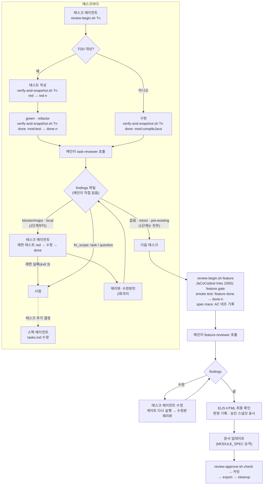

# Kiro spec workflow에 에이전트 코드 리뷰 단계를 추가하는 제안

> 결정론적 게이트가 보지 못하는 "맞는 걸 만들었는가"만 리뷰한다

- 작성일: 2026-11-02 (v2 개정: 2026-11-04, v2.1 개정: 2026-11-05)
- 상태: 제안 v2.1 (사내 Kiro 환경 검증 전)
- 대상: Kiro(IDE·CLI) spec workflow, Java/Spring(Spring Batch 포함), Gradle 멀티모듈, Spotless(Palantir Java Format), SpotBugs, JaCoCo
- 산출물: 이 문서, [스크립트](agent-code-review/scripts/), [Kiro 에이전트·steering·스킬 초안](agent-code-review/kiro/)
- 관련 문서: [서브에이전트는 언제 나누는가](2026-11-subagent-boundaries.md), [How the Claude Code team does code review](https://claude.dev/blog/solving-code-review-at-anthropic/)

## 목차

- [TL;DR](#tldr)
- [v2에서 바뀐 것](#v2에서-바뀐-것)
- [v2.1에서 바뀐 것](#v21에서-바뀐-것)
- [1. 현재 구조와 빈칸](#1-현재-구조와-빈칸)
- [2. 제안 전체 흐름](#2-제안-전체-흐름)
- [3. 리뷰 시점](#3-리뷰-시점)
- [4. 리뷰 항목](#4-리뷰-항목)
- [5. 리뷰 입력: 커밋 없는 스냅샷](#5-리뷰-입력-커밋-없는-스냅샷)
- [6. 에이전트 구성](#6-에이전트-구성)
- [7. 사람의 최종 확인](#7-사람의-최종-확인)
- [8. 도입 단계와 측정](#8-도입-단계와-측정)
- [9. 리뷰어 회귀 테스트](#9-리뷰어-회귀-테스트)
- [10. 위험도에 따른 리뷰 강도 (제안)](#10-위험도에-따른-리뷰-강도-제안)
- [11. 비용과 트레이드오프](#11-비용과-트레이드오프)
- [12. 검토했다 버린 대안](#12-검토했다-버린-대안)
- [13. 미검증 사항](#13-미검증-사항)
- [부록. 컴파일 시 소스 재작성과 편집 실패](#부록-컴파일-시-소스-재작성과-편집-실패)
- [참고 자료](#참고-자료)
- [변경 이력](#변경-이력)

## TL;DR

- **리뷰 단계를 추가합니다. 다만 범용 코드 리뷰가 아니라 지금 게이트가 구조적으로 보지 못하는 영역만 맡깁니다.** TDD는 "테스트가 통과하는가", SpotBugs는 "알려진 버그 패턴이 있는가", JaCoCo는 "실행됐는가"를 봅니다. 셋 다 "스펙대로 만들었는가"와 "그 테스트를 믿어도 되는가"는 보지 않습니다.
- **리뷰는 두 곳에 둡니다.** 태스크가 끝날 때(red→green→refactor 후 모듈 test 통과 직후) 그 태스크만 보는 리뷰("이 테스트를 믿어도 되나?")와, JaCoCo·smoke test 이후 문서 업데이트 전에 하는 feature 리뷰("합쳤을 때 스펙대로인가?")입니다.
- **가장 효과가 클 항목은 TR-2(Red 이후 테스트 변경)와 FR-2(태스크 사이 이음새)입니다.** TR-2는 에이전트가 테스트를 구현에 맞춰 고치는 행동을 잡습니다. FR-2는 태스크 단위 TDD로는 원리상 잡을 수 없는 영역입니다.
- **리뷰 범위는 에이전트의 보고가 아니라 git이 정하고, 스냅샷은 덮어쓰지 않고 번호를 붙입니다(red-1, done-1, red-2, done-2 …).** 커밋 없이 `commit-tree`와 워크트리별 ref로 찍으므로 pre-commit 훅, 커밋 로그, staging을 건드리지 않습니다.
- **Spec 세션의 역할을 나눕니다.** 메인은 위임과 갈래 나누기만 하고, 고치는 일은 태스크 에이전트, tasks.md 변경은 스펙 에이전트, 판단은 읽기만 하는 리뷰어가 합니다. 리뷰어 호출은 구현한 쪽이 아니라 메인이 합니다.
- **수정은 지적을 재현하는 테스트부터 시작합니다.** 재현되지 않으면 고치지 않고 사람에게 넘깁니다. 재리뷰는 수정분만 보고, 이전 지적을 반복하지 않으며, 2회까지입니다.
- **처음에는 리포트만 받습니다.** 사람이 지적마다 다섯 가지 판정(고침·틀림·의도됨·사소함·해로움)을 남기고, 항목별 채택률이 확인된 것만 차단으로 올립니다. 리뷰어 자체는 정답이 있는 사례 묶음으로 회귀 테스트합니다.
- **AC 추적은 리뷰어가 아니라 스크립트가 합니다.** [`spec-trace.mjs`](agent-code-review/scripts/spec-trace.mjs)가 requirements → design Property → 테스트 표시 → 실행 결과를 대조하고, 리뷰어는 연결된 테스트가 AC의 의미를 검증하는지만 판단합니다. 속성 기반 테스트(jqwik)를 약하게 만드는 변경은 [`pbt-candidates.sh`](agent-code-review/scripts/pbt-candidates.sh)가 후보로 뽑습니다.
- **리뷰어 모델은 Opus 5.5를 기본으로 두고, GLM-5를 비교 리뷰어로 1단계에서 측정합니다.** GPT-5.6 Sol은 과잉 지적 경험 때문에 제외합니다.

## v2에서 바뀐 것

v1을 [Claude Code 팀의 코드 리뷰 글](https://claude.dev/blog/solving-code-review-at-anthropic/)과 대조하고, 사내 Spec 세션 구조를 반영해 고쳤습니다.

| 항목 | v1 | v2 | 계기 |
| --- | --- | --- | --- |
| 스냅샷 이름 | `red`, `done` 고정 (다시 찍으면 덮어씀) | 번호를 붙여 모두 보존 (5.3절) | 재리뷰 때 비교 기준이 사라지고, 수정용 red를 다시 찍으면 TR-2 기준점이 지워지는 문제 |
| 재리뷰 범위 | 태스크 전체를 다시 봄 | 수정분만 보고 이전 지적은 `carried`로 상태만 기록 (6.6절) | 글: 반복 지적의 59%가 원래 있던 코드, 50라운드 넘게 돈 사례 |
| 수정 검증 | 수정 시 실패 테스트를 쓰라는 지시만 있음 | 재현 테스트를 red로 기록하고, 재현 실패면 고치지 않음 (6.6절) | 같은 모델끼리의 투표 대신 테스트 실행이라는 모델 독립적 검증 |
| 원래 있던 문제 | 구분 없음 | `origin: pre-existing`은 고치지 않고 백로그로 (4.10절) | 글의 Pre-existing 태그. 여기서 고치면 TR-3 위반 |
| FR-3 | JaCoCo 미커버 분기의 위험도 | 게이트 단계에서 추가된 테스트의 검증력 (4.7절) | JaCoCo 리포트는 모듈 전체라 원래 있던 코드 지적이 섞임. 예외를 삼키는 catch는 FR-2로 이동 |
| feature 리뷰 위치 | smoke test 뒤 | 그대로. 대신 리뷰 수정 후 게이트를 자동으로 다시 돌림 (3.2절) | 비싼 단계는 입력이 안정됐을 때 한 번, 싼 단계는 바뀔 때마다 |
| 에이전트 역할 | 메인 에이전트가 고침 | 메인은 위임·갈래 나누기, 태스크·스펙 에이전트가 수정 (6.1절) | 사내 Spec 세션에서 메인은 직접 수정할 수 없음 |
| 판정 기록 | 채택/기각 | fixed·wrong·intentional·minor·harmful (8.2절) | 기각 이유마다 고칠 곳이 다름. 글의 응답 분류 |
| 최종 확인 | "사람 확인 후 커밋" | ELI5 HTML에 지적·판정·승인 스냅샷을 연결하고, 커밋 전 승인 스냅샷과 비교 (7장) | 승인 후 변경 방지. 글: 승인은 특정 커밋에 묶임 |
| 리뷰어 평가 | 채택률만 | 정답 사례로 회귀 테스트하는 스킬 추가 (9장) | 채택률은 오탐만 보여주고 놓친 버그는 보여주지 않음 |
| 리뷰어 모델 | "가능하면 다른 모델" | Opus 5.5 기본, GLM-5 비교 측정, GPT-5.6 Sol 제외 (6.3절) | 과잉 지적 경험 (비용도 더 높음) |
| 늦은 수정 | 없음 | 수정 시작 기준점(`fixbase-<n>`)으로 그 수정만 재리뷰하고, 게이트와 feature 재리뷰를 다시 거침 (6.8절) | 1단계는 지적을 모았다가 최종 확인 때 고침 |
| 도입 순서 | 없음 | 파이프라인 확인 → 판정 측정 → 비교·평가·승인 장치 순으로 붙임 (8.4절) | 첫 도입에 장치가 많으면 실패 원인을 가르기 어려움 |
| 위험도 | 없음 | 브레인스토밍에서 등급을 정하고 리뷰가 읽는 약속 (10장, 제안) | 글: 위험 등급은 작성자가 아니라 변경이 정함 |

## v2.1에서 바뀐 것

사내 스펙 문서 형식(requirements의 EARS 줄바꿈, tasks의 `_Requirements:_`와 STC 제외, design의 Property와 Validates, 테스트의 `@Tag`)을 받아 AC 추적을 결정론으로 옮기고, 속성 기반 테스트(jqwik) 운영 규칙을 넣었습니다.

| 항목 | v2 | v2.1 | 계기 |
| --- | --- | --- | --- |
| AC 추적 (FR-1) | 리뷰어가 추적표(`trace`)를 직접 만듦 | `spec-trace.mjs`가 만들고, 리뷰어는 의미만 판단 (4.5절) | 스펙 품질검사는 requirements→tasks만 보장. tasks→테스트→결과는 기계로 대조할 수 있음 |
| 테스트의 AC 표시 | 규칙 없음 | 예시 테스트는 `**Validates: Requirements N.n**`, 속성 테스트는 Kiro `@Tag` 형식 유지 (4.5절) | 기존 표시가 javadoc, `@DisplayName`, 없음으로 섞여 있음 |
| 재사용 Property | 없음 | design.md에 `**Reuses: …**` 줄을 두고, 재사용이 새 AC를 덮는지는 리뷰어가 판단 (4.5절) | 재사용 참조가 Property 제목(자유 텍스트)에만 있어 기계가 따라갈 수 없음 |
| AC 해석 바꾸기 | 없음 | TR-1에 추가 (4.1절) | 테스트와 구현이 처음부터 다른 해석으로 일관되면 TR-2에 안 걸림 |
| 속성 테스트 약화 | 예시 테스트 기준(기대값 변경)만 | 생성 범위·가정·필터·tries·seed·edgeCases 변화를 `pbt-candidates.sh`로 뽑음 (4.2절, 4.11절) | jqwik에서는 단언을 그대로 두고 입력 공간을 줄여 통과시킬 수 있음 |
| tries | 에이전트가 테스트마다 지정 | 빌드 설정으로 단계별 고정 (태스크 200, 게이트 1000) (4.11절) | 검증 강도를 검증받는 쪽이 정하면 약화와 구분할 수 없음 |
| 반례 고정 | 재현 테스트 일반 규칙 | shrink된 반례를 `@Example`로 고정 (6.6절) | 무작위 생성이라 재현 여부가 실행마다 달라질 수 있음 |

## 1. 현재 구조와 빈칸

### 1.1 현재 워크플로우

| 단계 | 하는 일 | 검증 | 담당 |
| --- | --- | --- | --- |
| 스펙 | 브레인스토밍 → requirements → design → tasks | 사람이 리뷰 | 스펙 에이전트 |
| 개발 태스크 (비즈니스 로직) | 한 태스크 안에서 red → green → refactor | 해당 모듈 `test` 통과 | 태스크 에이전트 |
| 개발 태스크 (인터페이스, VO) | 구현 | `compileJava` 통과 | 태스크 에이전트 |
| JaCoCo report | 커버리지 측정 | 커버리지 기준 | 태스크 에이전트 |
| smoke test | 전체 빌드 | `build`, SpotBugs | 태스크 에이전트 |
| 문서 업데이트 | 백로그 완료 처리, 가이드 문서, MODULE_SPEC | – | 태스크 에이전트 |
| 최종 확인 | ELI5 HTML(목표, 코드 변경, 확인 질문)을 자동으로 띄움 | 사람이 확인 | 사람 |
| 마무리 | 전체 작업을 한 번에 커밋 | pre-commit 훅(Spotless) | – |

포맷은 `compileJava`가 `spotlessApply`에 의존하도록 걸려 있어서, 컴파일이나 테스트를 실행할 때마다 적용됩니다.

Spec 세션의 메인 에이전트는 코드나 문서를 직접 고치지 못합니다. 스펙 문서 작성·수정은 스펙 에이전트에게, 태스크 수행은 태스크 에이전트에게 위임합니다. 이 제안은 그 구조를 그대로 두고 리뷰어를 하나 더 붙입니다(6.1절).

### 1.2 각 게이트가 보장하는 것과 보장하지 않는 것

| 게이트 | 보장하는 것 | 보장하지 않는 것 |
| --- | --- | --- |
| TDD (`test`) | 테스트가 통과한다 | 테스트가 AC를 검증한다, 테스트가 중간에 바뀌지 않았다 |
| `compileJava` | 컴파일된다 | TDD 비대상 태스크에 로직이 들어오지 않았다 |
| SpotBugs | 알려진 버그 패턴이 없다 | 스펙대로 동작한다 |
| JaCoCo | 일정 비율 이상 실행됐다 | 기준을 채우려고 추가한 테스트가 무언가를 검증한다 |
| Spotless | 포맷이 일정하다 | (의미와 무관) |

오른쪽 열이 이 제안이 채우려는 빈칸입니다. 크게 세 가지입니다.

1. **테스트 신뢰성**: 초록불인 테스트가 실제로 무엇을 검증하는지
2. **스펙 정합성**: AC, 설계 결정, MODULE_SPEC 규칙과 코드가 맞는지
3. **이음새**: 태스크마다는 맞는데 합치면 깨지는 부분

**근거**

- 이 세 가지는 판단이 필요한 영역입니다. 같은 입력에 항상 같은 답을 내는 도구로는 표현하기 어렵습니다. 반대로 결정론적 도구로 표현할 수 있는 것(포맷, 버그 패턴, 레이어 의존)은 LLM에 맡기지 않는 것이 이 프로젝트의 원칙입니다(4.9절).

## 2. 제안 전체 흐름



## 3. 리뷰 시점

### 3.1 태스크 리뷰: 태스크 완료 직후, 다음 태스크 전

태스크의 `done` 검증(red→green→refactor 후 모듈 test)이 통과한 직후에, 그 태스크의 변경만 봅니다.

**근거**

- **결함은 가까운 곳에서 잡을수록 쌉니다.** 테스트를 구현에 맞춰 고친 흔적(TR-2)은 feature 끝에 가면 다른 태스크의 변경에 섞여서 찾기 어렵습니다. 다음 태스크가 그 테스트를 근거로 쌓이기도 합니다.
- **리뷰 입력이 작아야 정확합니다.** 태스크 하나의 diff는 리뷰어가 전부 읽을 수 있는 크기입니다. feature 전체 diff를 한 번에 주면 리뷰어도 훑어보게 됩니다. 스펙 검토 시간을 사람의 집중 한계(약 10분)로 자르는 것과 같은 이유입니다.

### 3.2 feature 리뷰: JaCoCo·smoke test 이후, 문서 업데이트 전

순서는 **개발 태스크 → JaCoCo → smoke test → feature 리뷰 → 최종 확인 → 문서 업데이트 → 커밋**입니다.

**근거**

- **비싼 단계는 입력이 안정됐을 때 한 번만, 싼 단계는 코드가 바뀔 때마다 다시 돌립니다.** 게이트는 자동이고 비용이 거의 들지 않습니다. 리뷰는 토큰이 들고 결과가 매번 조금씩 다릅니다. 게이트를 먼저 통과시켜야 리뷰어가 깨진 코드나 곧 바뀔 코드를 보지 않습니다.
- **리뷰 때문에 코드가 바뀌면 게이트를 다시 돌립니다.** 수정이 들어가면 태스크 에이전트가 JaCoCo와 smoke test를 다시 실행하고, 리뷰어는 그 수정분만 다시 봅니다(6.7절). JaCoCo 재산정 문제는 순서가 아니라 이 규칙으로 해결합니다.
- **문서 업데이트(MODULE_SPEC 승격) 직전이 스펙 드리프트를 잡을 마지막 지점입니다.** 승격되고 나면 코드와 다른 규칙이 "현재 상태 SSOT"가 됩니다. FR-4가 이 지점을 지킵니다.
- 리뷰어가 무엇을 보지 않을지는 순서가 아니라 체크리스트가 정합니다(4.9절). 순서가 정하는 것은 리뷰어가 최종에 가까운 코드를 본다는 점입니다.

### 3.3 리뷰를 두지 않는 시점

| 시점 | 두지 않는 이유 |
| --- | --- |
| 파일 저장마다 (hook) | 태스크 도중의 중간 상태는 원래 불완전합니다. 오탐만 늘고, 중간 관찰이 다음 결정을 바꾸는 TDD 루프를 방해합니다. |
| 태스크 안의 red 직후 | 이 시점의 테스트 품질(TR-1)은 done에서 함께 봐도 늦지 않습니다. red 스냅샷은 찍지만 리뷰는 하지 않습니다. |
| 커밋 이후 | 이미 한 번에 커밋하는 구조라서, 커밋 뒤의 리뷰는 되돌리는 비용만 큽니다. |

## 4. 리뷰 항목

한마디로 태스크 리뷰는 **"이 테스트를 믿어도 되나?"**, feature 리뷰는 **"조각을 합쳤을 때 스펙대로인가?"**를 봅니다. 항목 ID는 리뷰어 출력의 `check` 필드에 그대로 씁니다.

| ID | 단계 | 대상 | 질문 |
| --- | --- | --- | --- |
| TR-1 | 태스크 | TDD | 테스트가 AC를 실제로 검증하는가 |
| TR-2 | 태스크 | TDD | Red 이후 테스트가 구현에 맞춰 바뀌지 않았는가 |
| TR-3 | 태스크 | 전체 | 범위 밖의 코드가 들어왔는가 |
| TR-4 | 태스크 | 비TDD | TDD 비대상 태스크에 로직이 들어왔는가 |
| FR-1 | feature | 전체 | AC ↔ 테스트 ↔ 코드가 빠짐없이 대응하는가 |
| FR-2 | feature | 전체 | 태스크 사이 이음새와 오류 경로가 맞는가 |
| FR-3 | feature | 게이트 단계 | 게이트를 맞추려고 추가한 테스트가 무언가를 검증하는가 |
| FR-4 | feature | 전체 | 설계·MODULE_SPEC과 어긋나지 않는가, 승격할 규칙이 있는가 |

### 4.1 TR-1 테스트가 AC를 실제로 검증하는가

초록불이어도 아무것도 확인하지 않는 테스트가 있습니다. AC가 "VIP 회원은 10% 할인"일 때 이런 것들이 걸립니다.

```java
assertThat(result).isNotNull();                        // 값을 보지 않음
assertThat(result).isEqualTo(price * (1 - VIP_RATE));  // 구현과 같은 공식이라 둘 다 틀려도 통과
verify(repository).save(any());                        // 무엇을 저장했는지 보지 않음
```

기대값을 `9_000`처럼 리터럴로 쓰고, 저장된 객체의 필드까지 확인해야 AC를 검증한 것입니다.

속성 기반 테스트에서는 같은 문제가 속성 자체에 숨습니다. 속성이 `discount == price * 0.1`처럼 구현과 같은 식이면 둘 다 틀려도 통과합니다. 독립적인 오라클이나 관계(단조성, 왕복, 불변식)로 AC 문장을 표현했는지를 봅니다.

**AC 해석 바꾸기**도 여기서 봅니다. "10만 원 이상"을 처음부터 "초과"로 읽고 테스트와 구현을 그 해석으로 일관되게 쓰면, Red→Green도 정상이고 테스트가 중간에 바뀌지도 않아 TR-2에 걸리지 않습니다. AC 문장과 테스트의 의미를 직접 대조해야만 드러납니다. 의도라기보다 스펙의 모호한 부분을 에이전트가 말없이 한쪽으로 정한 결과인 경우가 많아서, 리뷰어 지시도 "속임수를 찾아라"가 아니라 "이 테스트가 AC 문장의 의미를 검증하는가"로 둡니다.

**근거**

- 태스크의 완료 조건이 "테스트 통과"이므로, 테스트가 약하면 완료 조건 자체가 무의미해집니다. JaCoCo 커버리지도 이런 테스트로 채워질 수 있습니다. 실행만 하고 단언하지 않는 테스트도 커버리지에는 잡히기 때문입니다.
- 사람이 엣지케이스 테스트를 먼저 쓰는 경우에도, 에이전트가 추가로 쓴 테스트는 이 검사가 필요합니다.

### 4.2 TR-2 Red 이후 테스트가 구현에 맞춰 바뀌지 않았는가

구현이 테스트를 통과하지 못할 때 에이전트는 테스트 쪽을 고치는 경향이 있습니다.

- `isEqualTo(9_000)`이던 기대값이 구현 결과에 맞춰 `9_100`으로 바뀜
- 경계값 테스트에 `@Disabled`가 붙음
- "10만 원 **이상**"을 검증하던 테스트가 조용히 "초과"로 바뀜

리뷰어는 이번 범위 안의 red 스냅샷 각각과 done 스냅샷 사이의 테스트 diff를 받습니다(5장). 한 태스크에서 테스트를 나눠 쓰며 red를 여러 번 확인했다면 그 red가 모두 기준이 됩니다. 변경이 있으면 스펙에 근거가 있는지 확인하고, 근거가 없으면 blocker로 기록합니다.

refactor 단계에서 생긴 테스트의 구조 변경(헬퍼·픽스처 추출, 이름 변경)은 단언의 의미가 같으면 TR-2가 아닙니다. TR-2가 보는 것은 기대값과 단언의 의미가 바뀐 경우뿐입니다.

속성 기반 테스트에서는 **단언을 그대로 두고 입력 공간을 줄이는 방식**으로도 통과시킬 수 있습니다.

| 변화 | 예 | 효과 |
| --- | --- | --- |
| 생성 범위 축소 | `between(0, 100_000)` → `between(0, 99_999)` | 경계값이 생성되지 않음 |
| 가정·필터 추가 | `Assume.that(...)`, `.filter(...)` | 실패하는 입력을 버림 (버리는 비율이 `maxDiscardRatio` 안이면 조용히 통과) |
| 시도 횟수 감소 | `@Property(tries = 10)` | 정책 값보다 적게 돎 |
| edge case 끔 | `edgeCases = EdgeCasesMode.NONE` | 0, 최솟값 같은 경계 입력이 빠짐 |
| seed 고정 | `seed = "42"` | 통과하는 입력만 반복 |
| 속성 약화 | `isEqualTo(...)` → `isGreaterThanOrEqualTo(0)` | 불변식이 의미를 잃음 |

마지막 줄을 뺀 나머지는 어노테이션이나 생성기 코드에 드러나므로, [`pbt-candidates.sh`](agent-code-review/scripts/pbt-candidates.sh)가 red→done 테스트 diff에서 후보를 뽑아 리뷰어에게 넘깁니다. 이번 범위에 새로 들어온 `tries`·`seed`·`edgeCases`·`Assume`·`filter`와 테스트 설정 파일(`build.gradle`, `junit-platform.properties`) 변경도 함께 뽑습니다.

**근거**

- **실제로 측정된 행동입니다.** ImpossibleBench는 스펙과 모순되도록 테스트를 고친 "불가능한" 과제를 만들어, 에이전트가 이를 통과하는 비율로 테스트 악용 경향을 쟀습니다. 실패하는 테스트를 버그를 고치는 대신 지워 버리는 행동을 대표 사례로 들고, Claude 계열 모델은 주로 테스트를 수정하는 방식으로 우회했다고 보고합니다. 테스트 접근을 제한하면 악용이 줄었습니다([Zhong et al., 2025](https://arxiv.org/abs/2510.20270)).
- **지시만으로는 막히지 않습니다.** METR은 최신 모델들이 테스트나 채점 코드를 고쳐 점수를 올리는 사례를 보고했습니다. 이 보고에서 한 과제에 "속이지 말라"는 지시를 추가해도 reward hacking 비율이 줄지 않았습니다([METR, 2025](https://metr.org/blog/2025-06-05-recent-reward-hacking/)). 그래서 steering 문구가 아니라 스냅샷 diff라는 증거로 확인합니다.
- **결정론적 증거가 있어 오탐이 적습니다.** 판단의 출발점이 "테스트 파일이 바뀌었다"는 사실이라서, 리뷰어가 추측할 여지가 다른 항목보다 작습니다. 처음부터 높은 채택률을 기대할 수 있는 항목입니다(8장).
- **red 스냅샷 없이는 이 검사가 성립하지 않습니다.** 태스크 끝에만 스냅샷을 찍으면 테스트가 처음부터 `9_100`이었는지, 중간에 `9_000`에서 바뀌었는지 구분할 수 없습니다. 그래서 태스크 안의 red 확인도 스크립트를 거칩니다.

### 4.3 TR-3 범위 밖의 코드가 들어왔는가

태스크는 "VIP 할인 계산"인데 diff에 이런 것이 섞인 경우입니다.

- AC에 없는 "GOLD 등급 5% 할인"이 추가됨 ("어차피 필요할 것 같아서")
- 상관없는 `MemberRepository` 쿼리 수정이나 캐시 추가

테스트는 모두 통과하니 게이트에 걸리지 않지만, 스펙에 없는 동작이 운영에 나가게 됩니다.

**근거**

- **스펙에 없는 코드는 리뷰도 테스트도 받지 않은 코드입니다.** SDD에서 스펙이 의미를 가지려면 "스펙에 없는 동작은 없다"가 성립해야 합니다.
- **이 검사는 리뷰 범위를 git이 정할 때만 작동합니다.** 에이전트가 넘긴 파일 목록으로 리뷰하면, 범위 밖에서 고친 파일은 목록에서 빠질 수 있고 그러면 검사 자체가 성립하지 않습니다(5.1절).

### 4.4 TR-4 TDD 비대상 태스크에 로직이 들어왔는가

"로직이 아니다"로 분류된 태스크가 TDD를 우회하는 통로가 될 수 있습니다. VO 생성 태스크인데 이렇게 쓰는 경우입니다.

```java
public record Money(long amount) {
    public Money {
        if (amount < 0) throw new IllegalArgumentException(); // 비즈니스 규칙
    }
    public Money applyDiscount(Grade grade) { ... }          // 로직
}
```

완료 조건이 `compileJava`뿐이라서 테스트 없이 규칙이 들어갑니다. 발견되면 `fix_scope: task`로 기록하고, 사람이 정하면 스펙 에이전트가 그 규칙을 다루는 TDD 태스크를 tasks.md에 추가합니다.

**근거**

- **완료 조건이 약한 곳으로 일이 몰립니다.** 비TDD 태스크의 완료 조건은 컴파일뿐이라서, 같은 코드를 TDD 태스크에 넣을 때보다 통과하기 쉽습니다.
- **후보는 결정론적으로 거릅니다.** [`logic-candidates.sh`](agent-code-review/scripts/logic-candidates.sh)가 이번 리뷰 범위의 추가된 줄에서 `if`, `switch`, `throw`, 스트림 연산, `BigDecimal` 같은 흔적을 뽑아 리뷰어에게 넘깁니다. record compact constructor의 검증처럼 경계가 애매한 경우가 있어서, 최종 판단은 리뷰어가 합니다.

### 4.5 FR-1 AC ↔ 테스트 ↔ 코드 추적

양방향으로 빈 곳을 찾습니다.

- **AC는 있는데 검증이 없음**: "할인 후 금액은 0원 미만 불가(AC 2.3)"에 연결된 테스트가 없거나, 있어도 실행되지 않았거나 실패함
- **코드는 있는데 AC가 없음**: `if (coupon != null)` 분기가 있는데 쿠폰 관련 AC가 없음. 누가 결정한 동작인지 알 수 없음

앞의 것은 **결정론으로**, 뒤의 것과 "연결된 테스트가 정말 그 AC를 검증하는가"는 **리뷰어가** 봅니다.

#### 사슬과 각 고리를 지키는 장치

| 고리 | 보장하는 것 |
| --- | --- |
| requirements → tasks | 스펙 품질검사 (기존). AC가 태스크에서 빠지지 않음 |
| AC → design Property | `**Validates: Requirements …**` |
| Property → 테스트 | 테스트의 `@Tag("Feature: <이름>, Property <N>: …")` |
| AC → 예시 테스트 | 테스트의 `**Validates: Requirements …**` 또는 `(AC 4.1, 4.4)` 표시 |
| 테스트 → 실행 결과 | test-results XML |
| 테스트가 AC의 의미를 검증하는가 | 리뷰어 (TR-1, FR-1) |

[`spec-trace.mjs`](agent-code-review/scripts/spec-trace.mjs)가 위 다섯 고리를 대조해 AC마다 `통과 / 일부 미실행 / 실패 / 미실행 / 연결 없음 / STC 제외 / 철회` 상태를 내고, smoke test 직후 `review/feature/trace-done-<n>.json`으로 남깁니다. 연결된 테스트가 모두 통과해야 `통과`이고, 하나라도 미실행·건너뜀이면 `일부 미실행`입니다. 파서가 낯선 소스에서 예외로 멈춰도 오류(`crash`)를 담은 파일을 남깁니다. feature 리뷰어는 이 파일을 입력으로 받습니다.

#### 읽는 형식 (사내 스펙 기준)

- **requirements.md**: `### Requirement <N>: 제목` 아래 `#### Acceptance Criteria`, 그 아래 줄 맨 앞의 `<n>. `이 AC `N.n`입니다. EARS 절마다 줄바꿈한 이어지는 줄(들여쓰기)은 같은 항목으로 묶습니다.
- **design.md**: `### Property <N>: 제목` 절 안의 `**Validates: Requirements 4.1, 4.3**`. 기존 테스트를 재사용하면 `**Reuses: <테스트 클래스> (Feature: <원래 feature>, Property 4, 11)**`를 둡니다.
- **tasks.md**: `_Requirements: 1.2, 1.3_`(대소문자 무관), `**Property <N>: …** - **Validates: Requirements …**`, `STC 적용 제외`. STC 제외 태스크만 가리키는 AC는 테스트 연결을 요구하지 않습니다(`STC 제외`).
- **테스트**: `*PropertyTest.java`의 `@Tag("Feature: <이름>, Property <N>: …")`가 Property 연결입니다. 예시 테스트는 javadoc의 `**Validates: Requirements 1.3, 1.7**`나 `@DisplayName`·`@Label`의 `(AC 4.1, 4.4)`를 AC 직접 연결로 읽고, `**Validates: Requirements 1.3 (Feature: <이름>)**`처럼 feature를 담은 표시도 읽습니다. 클래스에 붙은 표시는 그 클래스의 모든 테스트 메서드에 적용합니다.
- **취소선 AC**: 본문이 `~~`로 시작하는 AC는 지운 AC(`철회`)로 보고 태스크·테스트 연결을 요구하지 않습니다. 번호는 그대로 차지합니다. tasks나 테스트가 지운 AC를 가리키면 경고합니다.
- **Feature 이름**: 스펙 디렉터리 이름에서 앞의 인덱스를 뺀 값입니다(`.kiro/specs/<SpecModuleKey>/01-<SpecDirectoryName>` → `<SpecDirectoryName>`).

#### 규칙

- **AC 번호만 적힌 표시는 이번 feature에서 바뀐 테스트 파일에서만 인정합니다.** `(AC 4.1)`은 어느 feature의 4.1인지 말하지 않습니다. 저장소 전체에서 인정하면 예전 feature 테스트의 `(AC 4.1)`이 이번 AC 4.1을 덮은 것처럼 보입니다. Property 태그와 `(Feature: <이름>)`을 담은 표시는 feature가 분명하므로 범위와 상관없이 그 feature에서만 인정합니다. 범위 제한은 feature가 없는 표시의 대체 규칙입니다.
- **feature를 담은 표시는 지금은 필요한 곳에만 씁니다.** 이번 feature에서 고치지 않는 기존 테스트를 이번 AC에 연결할 때, 다른 feature의 AC 표시가 있는 파일을 고칠 때입니다. 모든 표시에 feature를 넣을지는 표시가 길어지는 비용이 있어서, 1단계에서 잘못 집계되는 경우가 실제로 나오면 정합니다(13장).
- **재사용은 주장이므로 확인 대상입니다.** 스크립트는 `Reuses`가 가리키는 테스트가 있고 이번 실행에서 통과했는지만 봅니다. 재사용한 속성이 새 AC의 의미까지 덮는지는 리뷰어가 판단합니다.
- **스펙 승인 뒤에는 AC 번호를 바꾸지 않습니다.** requirements.md의 AC에는 ID가 적혀 있지 않고, `N.n`은 위치에서 나옵니다. 중간에 AC를 넣거나 빼면 뒤 번호가 밀려 테스트 표시가 다른 AC를 가리킵니다. 삭제는 취소선으로 남기고, 추가는 끝에 붙입니다. 스크립트는 번호가 연속되지 않으면 경고합니다.
- **형식이 깨지면 조용히 통과하지 않습니다.** AC를 하나도 못 읽으면 오류로 멈춥니다(`no-ac-parsed`). 없는 AC·Property를 가리키는 참조, 재사용 대상이 없는 경우도 오류입니다. 형식이 바뀌어 대조가 0건으로 "통과"되는 것이 가장 위험한 실패이기 때문입니다.
- **이번 변경에서 AC·Property 표시가 없는 테스트는 목록으로 냅니다.** 헬퍼 검증처럼 AC와 직접 연결되지 않는 테스트는 javadoc에 `**No-AC: <이유>**`를 달아 목록에서 뺍니다. 1단계에서는 경고로만 두고, 새 테스트의 표시 규칙(아래)이 자리 잡으면 차단으로 올릴지 정합니다.

새 테스트의 표시 규칙은 절차 steering에 둡니다. 예시 테스트는 메서드 javadoc에 `**Validates: Requirements N.n**`을 쓰고(design.md·tasks.md와 같은 어휘라 에이전트가 일관되게 씀), 속성 테스트는 Kiro가 만드는 `@Tag` 형식을 그대로 둡니다.

**근거**

- **스펙 품질검사는 앞의 고리만 보장합니다.** tasks.md에 "AC 2.3 구현"이 적혀 있어도, 테스트가 약하거나 Red 이후 바뀌었거나 AC를 다르게 해석했다면 사슬은 끊깁니다. 남은 고리 중 연결과 실행 여부는 기계가 볼 수 있고, 의미만 판단이 필요합니다.
- **결정론으로 옮길 수 있는 것은 LLM에 맡기지 않습니다(4.9절).** v2에서는 리뷰어가 AC마다 테스트를 찾아 추적표를 만들었습니다. 그 작업은 매번 결과가 흔들리고, 리뷰어의 주의를 의미 판단에서 빼앗습니다.
- **"구현되지 않은 스펙 문장은 스펙 결함이 아니라 구현이나 태스크 분해의 실패 신호"**라는 기존 원칙을 검사로 옮긴 것입니다. 추적표는 최종 확인 HTML, MODULE_SPEC 승격, 스펙 정리(수락 조건 테스트로 흡수된 스펙 삭제)의 입력으로도 씁니다.

### 4.6 FR-2 태스크 사이 이음새와 오류 경로

태스크마다 따로 보면 맞는데 합치면 깨지는 경우입니다. 정산 배치 예시입니다.

- **트랜잭션**: 태스크 2의 Writer가 정산을 저장하고, 태스크 3이 같은 청크 안에서 알림을 보냄 → 청크가 롤백돼도 알림은 이미 발송됨
- **예외 전파**: 태스크 1은 `IllegalStateException`을 던지는데 태스크 3의 skip 정책은 `ValidationException`만 skip → 데이터 한 건 때문에 Job 전체가 실패
- **재시작과 멱등성**: Writer가 단순 INSERT라서 실패 후 재실행하면 정산이 중복 생성됨
- **오류 경로**: 새 코드가 예외를 잡아 로그만 남기고 삼킴 → 조용한 데이터 유실

```java
catch (DataIntegrityViolationException e) {
    log.warn("duplicate");  // 테스트가 지나지 않는 경로 + 예외를 삼킴
    return;
}
```

**근거**

- **태스크 단위 TDD로는 원리상 잡을 수 없습니다.** 각 태스크의 테스트는 자기 단위의 계약만 검증합니다. 경계를 넘는 상호작용은 어느 태스크의 테스트에도 속하지 않습니다.
- **스펙 분할 경계에서 결합 결정이 사라지는 문제와 같은 구조입니다.** 스펙 분할 때 이음새 결정을 선행 계약 스펙(spec-0)으로 뽑아내듯, 구현 쪽 이음새는 feature 리뷰에서 확인합니다.
- **오류 경로는 JaCoCo 없이 diff만으로 볼 수 있습니다.** v1은 이것을 JaCoCo 미커버 분기(구 FR-3)로 찾으려 했지만, 새 코드의 catch·skip·retry 경로는 diff에 그대로 보입니다.
- Spring Batch의 재시작·skip 설계 기준은 [Spring Batch 재시작·오류 처리 설계 제안](../spring-batch/2026-10-spring-batch-restart-and-skip-design.md)을 리뷰어의 참고 자료로 줄 수 있습니다.

### 4.7 FR-3 게이트 단계에서 추가된 테스트

JaCoCo 기준을 못 넘기면 에이전트는 테스트를 추가해 기준을 맞춥니다. 이 테스트는 개발 태스크가 끝난 뒤에 생기므로 어느 태스크 리뷰에도 걸리지 않습니다.

```java
@Test
void coverage() {
    new SettlementWriter(repo, notifier).write(chunk);  // 실행만 하고 아무것도 확인하지 않음
}
```

feature 리뷰어는 `gates`(마지막 개발 태스크가 끝난 시점)와 `done-1` 사이에 바뀐 테스트에 TR-1 기준을 적용합니다. 2회차부터는 수정분에 들어온 테스트를 같은 기준으로 봅니다.

**근거**

- **커버리지 수치 게이트는 Goodhart 함정이 생기는 바로 그 지점입니다.** 수치를 채우는 가장 싼 방법은 단언 없는 테스트입니다. 수치 게이트는 그대로 두고, 수치를 채우려고 추가된 테스트만 따로 봅니다.
- v1의 FR-3(JaCoCo 미커버 분기의 위험도)은 뺐습니다. JaCoCo 리포트는 모듈 전체를 다루므로 원래 있던 코드의 미커버 분기까지 걸리고(4.10절), 새 코드의 위험한 오류 경로는 FR-2가 diff로 봅니다.

### 4.8 FR-4 설계·MODULE_SPEC 정합성과 승격 후보

- **설계 위반**: design.md는 "도메인은 Spring에 의존하지 않는다"인데 도메인 클래스에 `@Value`가 들어감
- **규칙 위반**: MODULE_SPEC은 "금액은 원 단위 절사"인데 코드는 `RoundingMode.HALF_UP`
- **승격 후보**: 구현 중에 "할인 중복 적용 불가"라는 규칙이 생겼는데 스펙 어디에도 없음 → `question`으로 보고

승격 후보는 리뷰어나 다른 에이전트가 MODULE_SPEC에 직접 쓰지 않고, 사람이 최종 확인에서 결정합니다.

**근거**

- 3.2절과 같습니다. MODULE_SPEC은 현재 상태의 SSOT이므로, 코드와 어긋난 채 승격되면 이후 모든 스펙과 리뷰가 틀린 기준을 따르게 됩니다.
- 설계 위반 중 레이어 의존처럼 규칙으로 쓸 수 있는 것은 ArchUnit 테스트로 옮기는 것이 낫습니다(4.9절). FR-4에는 규칙으로 표현하기 어려운 도메인 규칙과 설계 의도만 남깁니다.

### 4.9 리뷰하지 않는 것

| 대상 | 맡는 곳 |
| --- | --- |
| 포맷, 스타일 | Spotless (compileJava, pre-commit) |
| 알려진 버그 패턴 | SpotBugs (리뷰어는 중복을 피하려고 결과만 참고) |
| 커버리지 수치 | JaCoCo 태스크. 리뷰어는 JaCoCo 리포트를 입력으로 받지 않음 |
| 레이어·패키지 의존 규칙 | ArchUnit 도입 권장 |
| 이름, 메서드 길이 같은 취향 | 리뷰하지 않음 |

**근거**

- **결정론으로 바꿀 수 있는 것을 LLM에 맡기면 매번 결과가 흔들리고 노이즈가 쌓입니다.** 노이즈가 많아지면 사람이 리뷰 결과를 읽지 않게 되고, 정말 중요한 지적도 묻힙니다.
- **작성자가 에이전트면 노이즈는 무해하지 않습니다.** 사람은 사소한 지적을 넘기지만 에이전트는 지적을 지시로 받아 실행합니다. 리뷰 코멘트가 곧 다음 턴의 프롬프트입니다. Claude Code 팀이 스타일·정리성 지적을 아예 버리고, 문제없는 PR에 리뷰어를 돌려 해로운 수정을 유도하는 비율까지 재는 이유입니다.

### 4.10 이번 변경인가, 원래 있던 것인가

모든 지적에 `origin`을 붙입니다. 문제가 리뷰 범위의 시작 시점(`review_from`, feature는 `start`) 코드에 이미 있었다면 `pre-existing`, 이번 변경이 만들었다면 `introduced`입니다.

- `pre-existing` 지적은 수정 루프에 넣지 않습니다. 최종 확인 HTML의 백로그 후보 목록에만 올립니다.
- 리뷰어는 `git show <review_from>:<path>`로 원래 코드를 확인할 수 있습니다.

**근거**

- **원래 있던 버그를 이번 태스크에서 고치면 그 자체가 TR-3(범위 이탈)입니다.** 지금 feature와 상관없는 변경이 커밋에 섞입니다.
- **구분하지 않으면 리뷰 루프가 끝나지 않습니다.** Claude Code 팀은 리뷰어가 반복해서 지적한 것의 약 59%가 첫 리뷰 때부터 있던 코드였다고 보고했습니다. 이후 회차는 새 버그가 아니라 오래된 버그를 계속 찾아낸 것입니다. 그래서 그 팀도 원래 있던 버그에 Pre-existing 태그를 붙여 작성자에게 돌리지 않습니다.

### 4.11 속성 기반 테스트(jqwik) 운영 규칙

비즈니스 로직 테스트는 jqwik(1.9.3)으로 속성 기반 테스트를 쓰고, 파일 이름은 `*PropertyTest.java`로 끝납니다. 리뷰가 의미를 가지려면 다음 운영 규칙이 함께 필요합니다. 규칙은 절차 steering에 두고, 어기면 `pbt-candidates.sh`가 후보로 뽑습니다(규칙과 탐지가 같은 목록을 봄).

| 규칙 | 내용 |
| --- | --- |
| tries는 빌드 설정이 정함 | 테스트 코드에 `tries`를 쓰지 않음. 태스크 단계 200, feature 게이트 1000. 정말 비싼 속성만 예외로 쓰고 바로 위에 `// tries: <이유>` 주석 |
| 실패 입력을 피하는 변경 금지 | 생성 범위 좁히기, `Assume`·`filter` 추가, `edgeCases` 끄기, `seed` 고정을 하지 않음. 테스트가 스펙과 맞지 않다고 보면 고치지 말고 보고 |
| 반례는 `@Example`로 고정 | jqwik이 shrink한 반례를 `@Example`로 추가하고 `@Property`는 그대로 둠 (6.6절) |
| 오라클은 독립적으로 | 기대값을 구현과 같은 식으로 계산하지 않음. 독립 오라클이나 관계(단조성, 왕복, 불변식)로 표현 |
| 테스트 설정은 범위 안에서만 | `build.gradle`의 test 블록, `junit-platform.properties`는 태스크 범위에 명시된 경우에만 바꿈 |
| `.jqwik-database`는 무시 목록에 | 실패 seed를 기록하는 파일이 스냅샷(`git add -A`)에 들어가 매 회차 diff 노이즈가 되지 않게 함 |

tries는 이렇게 넘깁니다. jqwik은 설정을 JUnit Platform 설정 파라미터로 읽고, JUnit Platform은 JVM 시스템 속성을 `junit-platform.properties`보다 먼저 봅니다.

```groovy
test {
    // 태스크 단계 200, feature 게이트와 smoke test에서는 -PpbtTries=1000
    systemProperty 'jqwik.tries.default', findProperty('pbtTries') ?: '200'
}
```

게이트와 smoke test에는 같은 값을 넘깁니다. `systemProperty` 값은 Gradle test 태스크의 입력이라, 값이 다르면 smoke test에서 전체 테스트가 다시 돌고 AC 대조가 읽는 결과도 200회 실행 결과가 됩니다. 같은 값이면 test 태스크가 UP-TO-DATE로 건너뛰고 게이트 실행 결과가 남습니다.

**근거**

- **검증 강도를 검증받는 쪽이 정하면 약화와 구분할 수 없습니다.** 에이전트가 테스트마다 tries를 정하면, 속도 때문에 200으로 둔 것과 실패 입력을 피하려고 줄인 것이 diff에서 똑같이 보입니다. 정책 값을 코드 밖으로 빼면 코드에 `tries =`가 새로 나타나는 것 자체가 신호가 됩니다.
- **속도와 탐지력을 단계로 나눕니다.** 태스크 루프는 red/green을 빨리 확인하는 곳이라 200회로 충분합니다. 버그를 찾는 역할은 게이트의 1000회가 맡습니다. 지금은 에이전트가 정한 100~200회가 최종 강도인데, 이 방식에서는 게이트에서 한 번 더 걸러집니다.
- **기존 테스트의 `tries =`는 별도 커밋으로 한 번에 지웁니다.** 어노테이션 값이 전역 설정보다 우선이라, 남겨 두면 그 속성들은 게이트에서도 100~200회로만 돕니다. 일괄 삭제 커밋은 feature 작업 밖에서 하므로 리뷰 범위에 섞이지 않습니다. feature 안에서 `tries`를 지우면 `pbt-candidates.sh`가 `[-]` 줄로 보여주고, 기본값보다 큰 값(예: 2000)을 지운 경우처럼 오히려 약해지는지는 리뷰어가 판단합니다.
- **1000회가 체감될 만큼 느리면 tries보다 속성의 경계를 봅니다.** 순수 도메인 객체를 다루는 속성은 1000회도 보통 금방 끝납니다. 느리다면 속성 하나가 매번 Spring 컨텍스트나 무거운 mock, 외부 연동을 거치고 있을 수 있습니다.
- **`@Tag` 값은 실행 시점의 태그가 아니라 소스의 메타데이터입니다.** JUnit 태그 규칙상 공백과 쉼표가 들어간 태그는 무효라 경고 후 무시됩니다. Kiro가 만드는 관례라 바꾸지 않고, `spec-trace.mjs`는 소스를 정적으로 읽어 씁니다. `includeTags`로 속성만 골라 돌리는 용도로는 쓸 수 없습니다.

## 5. 리뷰 입력: 커밋 없는 스냅샷

### 5.1 에이전트가 파일 목록을 넘기지 않는 이유

태스크마다 커밋하지 않으므로 diff의 기준점이 없습니다. 가장 쉬운 방법은 태스크 에이전트가 작업한 파일 목록을 리뷰어에게 넘기는 것이지만, 채택하지 않습니다.

**근거**

- **리뷰받는 쪽이 리뷰 범위를 정하는 구조입니다.** 이는 서브에이전트 성공 오보고 문제와 같은 구조이고, 그 문제의 해결 방향(텍스트 보고 대신 기계가 읽을 수 있는 아티팩트를 직접 파싱)과도 맞지 않습니다.
- **고의가 아니어도 빠집니다.** 컨텍스트가 압축되면 앞서 고친 파일을 잊을 수 있습니다. 빠진 파일이 바로 범위 밖 수정이라면 TR-3이 작동하지 않습니다.

원칙은 **"에이전트는 언제(스냅샷 시점)만 정하고, 무엇(변경 내용)은 git이 정한다"**입니다.

### 5.2 스냅샷 방식

[`review-snapshot.sh`](agent-code-review/scripts/review-snapshot.sh)(실제 처리는 [`review-lib.sh`](agent-code-review/scripts/review-lib.sh))는 현재 작업 트리를 임시 인덱스에 담아 tree 객체를 만들고, `git commit-tree`로 커밋 객체를 만든 뒤 `refs/worktree/review/<target>/<label>`에 기록합니다.

| 성질 | 이유 | 임시 저장소 검증 |
| --- | --- | --- |
| pre-commit 훅이 돌지 않음 | 훅은 `git commit`(porcelain)에서만 실행되고 `commit-tree`(plumbing)는 실행하지 않음 | 훅 실행 흔적 없음 |
| 커밋 로그에 남지 않음 | 브랜치가 아니라 별도 ref에만 연결 | `git log`에 init 커밋만 보임 |
| staging을 건드리지 않음 | `GIT_INDEX_FILE`로 실제 인덱스의 사본을 사용 | 미리 staging한 파일 상태 유지 |
| 신규 파일 포함 | `git add -A`가 untracked 파일을 포함 (`.gitignore`는 지킴) | 새 테스트 파일이 diff에 `A`로 나옴 |
| 워크트리끼리 충돌 없음 | `refs/worktree/*`는 워크트리별 ref | 다른 워크트리의 같은 태스크 ID와 섞이지 않음 |
| 정리가 쉬움 | ref와 기록이 워크트리의 git 디렉터리에 있음 | `review-cleanup.sh` 후 ref 0개 |

**근거**

- 사내에서는 `.worktrees/` 아래에 워크트리를 만들어 병렬로 작업합니다. 모든 워크트리가 공유하는 `refs/review/*`를 쓰면 두 워크트리가 같은 태스크 ID(T3)를 쓸 때 서로 덮어씁니다. `refs/worktree/*`는 git이 워크트리마다 따로 두는 네임스페이스입니다.
- 기록(`*.result`, findings, 판정)도 `git rev-parse --git-path review`로 워크트리별 git 디렉터리에 둡니다. 작업 트리를 더럽히지 않고, 워크트리를 지우면 함께 사라집니다.

### 5.3 번호 규칙: 덮어쓰지 않는다

v2의 가장 큰 변경입니다. 같은 이름의 스냅샷을 다시 찍으면 덮어쓰지 않고 다음 번호를 붙입니다.

| ref | 의미 | 리뷰에서의 쓰임 |
| --- | --- | --- |
| `<target>/start` | 태스크 시작 기준(직전 태스크의 마지막 done, 없으면 HEAD). feature는 HEAD | 1회차 리뷰 범위의 시작, `origin` 판단 기준 |
| `feature/gates` | 마지막 개발 태스크가 끝난 시점 | FR-3(게이트 단계 테스트)의 기준 |
| `<target>/red-<n>` | red 확인 시점. 태스크 안의 red와 수정 루프의 red 모두 | TR-2 기준. 수정 루프의 red가 `not-red`면 재현 실패 |
| `<target>/done-<n>` | 검증 통과 시점. **n이 곧 리뷰 회차** | 1회차: start→done-1, n회차: fixbase-n(없으면 done-(n-1))→done-n |
| `<task>/fixbase-<n>` | 태스크 지적을 고치기 시작한 시점의 `_last` (`review-begin.sh <task> --fix`) | n회차 범위의 시작. 다른 태스크가 지나간 뒤 늦게 고쳐도 이 수정만 범위에 들어감 (6.8절) |
| `<target>/fail-<n>` | done 검증이 실패한 시점 | 증거로만 남김. 회차에 넣지 않음 |
| `feature/gate-<n>` | JaCoCo 기준 검사 실행 시점 | 회차에 넣지 않음. 가장 최근 gate가 실패했으면 리뷰하지 않음 (5.6절) |
| `_last` | 가장 최근에 통과한 done | 다음 태스크의 start |
| `approved` | 사람이 최종 확인에서 승인한 스냅샷 | 커밋 전 비교(7장) |

이 규칙 하나로 다음이 해결됩니다.

- **태스크 안에서 red를 여러 번 확인해도 모두 남습니다.** 앞의 red가 지워져 TR-2 기준이 사라지는 일이 없습니다.
- **수정 루프의 red가 따로 남습니다.** 재현 테스트가 실제로 실패했는지가 기록되고, 실패하지 않았으면(exit 3) 지적한 버그가 재현되지 않은 것입니다.
- **재리뷰가 수정분만 봅니다.** done-(n-1)과 done-n이 둘 다 남아 있으므로 그 사이의 차이만 리뷰할 수 있습니다. 다른 태스크가 지나간 뒤에 고치는 경우에는 수정 시작 시점(fixbase-n)부터 봅니다.
- **실패한 검증도 증거로 남습니다.** 검증에 실패한 done은 fail-n이 되어 회차를 늘리지 않고, 그 뒤에 리뷰를 요청하면 리뷰어가 막습니다(5.6절).

리뷰어와 메인은 ref 이름을 직접 조립하지 않습니다. [`review-status.sh`](agent-code-review/scripts/review-status.sh)가 회차, 이번 리뷰 범위, 범위 안의 red, 직전 회차 findings, 리뷰 가능 여부를 한 번에 알려줍니다.

```
$ scripts/review/review-status.sh T3
target=T3
start=refs/worktree/review/T3/start
snapshot seq=1 label=red-1 exit=1 red=confirmed
snapshot seq=2 label=done-1 exit=0
findings=.git/review/T3/findings-1.json
snapshot seq=3 label=red-2 exit=1 red=confirmed
snapshot seq=4 label=done-2 exit=0
round=2
review_from=refs/worktree/review/T3/done-1
review_to=refs/worktree/review/T3/done-2
reds=refs/worktree/review/T3/red-2
previous_findings=.git/review/T3/findings-1.json
ready=yes
```

### 5.4 포맷 일관성

`compileJava`가 `spotlessApply`를 실행하므로 컴파일이나 테스트 뒤의 소스는 항상 포맷된 상태입니다. 스냅샷끼리 포맷 상태가 다르면 줄바꿈만 바뀐 diff가 생깁니다. 특히 red와 done 사이라면 TR-2 오탐이 됩니다. Palantir Java Format은 줄 구조까지 바꾸기 때문에 `git diff -w`로도 걸러지지 않습니다.

그래서 규칙은 하나입니다. **스냅샷 체인 안에서 포맷 상태가 일정해야 합니다.** 다음 두 가지로 보장합니다.

1. **start 스냅샷을 따로 찍지 않습니다.** [`review-begin.sh`](agent-code-review/scripts/review-begin.sh)는 `start`를 직전 태스크의 마지막 done(없으면 HEAD)으로 둡니다. HEAD는 pre-commit 훅이, done은 compileJava가 포맷을 보장합니다.
2. **검증 명령과 스냅샷을 한 스크립트로 묶습니다.** [`verify-and-snapshot.sh`](agent-code-review/scripts/verify-and-snapshot.sh)가 Gradle을 실행한 직후에 스냅샷을 찍습니다. 에이전트가 순서를 지키는 데 기대지 않습니다.

**근거**

- 태스크 단계에서 빌드 대신 `compileJava`/`test`만 쓰는 지금 구조를 바꿀 필요가 없습니다. 둘 다 `spotlessApply`를 거치므로 빌드로 바꿔도 얻는 것이 없고 속도만 느려집니다.
- 예외는 문법 오류로 `spotlessApply` 자체가 실패하는 경우입니다. 이때는 포맷 전 상태가 기록됩니다. done이라면 fail-n으로 남아 리뷰 대상이 되지 않지만, red라면 리뷰어가 red→done diff에서 포맷 노이즈를 볼 수 있습니다(13장).

### 5.5 태스크 유형별 스냅샷

| 태스크 유형 | 완료 조건 | 스냅샷 | 태스크 리뷰 |
| --- | --- | --- | --- |
| 비즈니스 로직 (TDD) | 모듈 `test` | start / red-n (하나 이상) / done-n | TR-1, TR-2, TR-3 |
| 인터페이스·VO | `compileJava` | start / done-n | TR-3, TR-4 |
| JaCoCo report | `test`(tries 1000) + 커버리지 기준 검사 (`jacocoTestCoverageVerification` 등) | feature/gate-n | – |
| smoke test | `build -PpbtTries=1000` (+ SpotBugs), 직후 `spec-trace.mjs --record feature` | feature/start(HEAD) / gates / done-n | FR-1 ~ FR-4 |

JaCoCo gate에는 커버리지 기준을 검사하는 태스크가 들어가야 합니다. `jacocoTestReport`는 리포트만 만들고 기준에 못 미쳐도 실패하지 않습니다. 사내에서 기준을 검사하는 태스크 이름은 확인이 필요합니다(13장).

`verify-and-snapshot.sh`는 red 단계에서 테스트가 **실패해야** 0을 반환하고, 이미 통과하면 3을 반환합니다. 태스크 안에서는 Red를 거치지 않은 TDD를 막고, 수정 루프에서는 재현되지 않는 지적을 걸러냅니다. red 확인이 느리면 `--tests`로 새 테스트 클래스만 돌려도 됩니다. 완료 조건은 지금처럼 모듈 전체 `test`입니다.

### 5.6 기계가 읽을 수 있는 검증 결과

`verify-and-snapshot.sh`는 각 스냅샷의 Gradle 종료 코드, red 판정, 스냅샷 id, 순번을 `<label>.result`로 남기고, 테스트 태스크 하나를 실행했다면 `build/test-results/test`의 XML도 복사해 둡니다. 리뷰어는 테스트가 실제로 돌았고 통과했는지를 에이전트의 보고가 아니라 이 파일로 확인합니다.

`review-status.sh`는 통과한 done이 없거나, 최신 done 뒤에 실패한 검증(fail-n, 실패한 gate-n)이 있거나, 가장 최근 gate가 실패했으면 `ready=no`를 냅니다. 그러면 리뷰어는 리뷰하지 않고 blocker(`TR-0`/`FR-0`) 하나만 `record-findings.sh <target> --blocked`로 기록합니다(fail-closed). 이 기록은 회차와 무관한 `blocked-<k>.json`으로 남고, 메인은 태스크를 다시 위임합니다.

**근거**

- 에이전트가 스냅샷 호출을 빼먹을 수는 있습니다. 하지만 그 실패는 "ref가 없다"는 사실로 바로 드러납니다. 내용을 빠뜨리는 실패보다 훨씬 다루기 쉬운 실패입니다.
- **gate는 "최신 done 뒤"만 봐서는 부족합니다.** JaCoCo gate가 실패한 채 gate를 다시 돌리지 않고 smoke test로 넘어가면, 실패가 최신 done보다 앞에 있어서 그 규칙으로는 잡히지 않습니다. 그래서 가장 최근 gate의 결과를 따로 봅니다.
- 검증 결과를 훅이 아니라 스크립트에 두는 이유도 같습니다. Kiro 문서에 따르면 서브에이전트 안에서는 훅이 실행되지 않으므로([Kiro subagents](https://kiro.dev/docs/chat/subagents/)), 위임된 태스크 에이전트의 행동에 훅을 걸 수 없습니다.

### 5.7 스크립트 목록

프로젝트의 `scripts/review/`에 두는 것을 전제로 합니다. 의존성은 git과 bash 4 이상이고, `.mjs` 두 개만 Node.js 18+가 필요합니다(jq는 있으면 findings 형식과 판정 index 검사에 씀). GNU 전용 옵션은 쓰지 않습니다.

| 스크립트 | 역할 | 호출하는 쪽 |
| --- | --- | --- |
| [`review-lib.sh`](agent-code-review/scripts/review-lib.sh) | 공통 함수 (번호 규칙, 스냅샷, 회차 계산) | 다른 스크립트가 source |
| [`review-begin.sh`](agent-code-review/scripts/review-begin.sh) | 태스크·feature 시작 기준점, 수정 시작 기준점(`--fix`) 기록 | 태스크 에이전트 |
| [`verify-and-snapshot.sh`](agent-code-review/scripts/verify-and-snapshot.sh) | Gradle 검증 + 번호 붙은 스냅샷 + 결과 기록 | 태스크 에이전트 |
| [`review-snapshot.sh`](agent-code-review/scripts/review-snapshot.sh) | 검증 없이 스냅샷만 (수동용) | 사람 |
| [`review-status.sh`](agent-code-review/scripts/review-status.sh) | 회차, 리뷰 범위, red 목록, 리뷰 가능 여부 | 리뷰어 |
| [`logic-candidates.sh`](agent-code-review/scripts/logic-candidates.sh) | 비TDD 태스크의 로직 후보 추출 | task-reviewer |
| [`record-findings.sh`](agent-code-review/scripts/record-findings.sh) | 회차별 findings 기록 (리뷰어의 유일한 쓰기 통로) | 리뷰어 |
| [`record-resolution.sh`](agent-code-review/scripts/record-resolution.sh) | 사람의 판정 기록 | 태스크 에이전트 (최종 확인 후) |
| [`review-approve.sh`](agent-code-review/scripts/review-approve.sh) | 승인 스냅샷 기록과 커밋 전 비교 (훅 안에서는 `--index`) | 태스크 에이전트 또는 pre-commit 훅 |
| [`review-export.mjs`](agent-code-review/scripts/review-export.mjs) | 정리 전 지적·판정을 지표 파일(기본: 메인 저장소 git 디렉터리)로 내보내고 항목별 집계 | 태스크 에이전트 (커밋 후) |
| [`review-cleanup.sh`](agent-code-review/scripts/review-cleanup.sh) | 리뷰 ref와 기록 정리 (`eval-`만 지우기 가능) | 태스크 에이전트 (커밋 후) |
| [`eval-setup.sh`](agent-code-review/scripts/eval-setup.sh) | 리뷰어 평가 사례를 스냅샷으로 만듦 | reviewer-eval 스킬 |
| [`eval-score.mjs`](agent-code-review/scripts/eval-score.mjs) | 정답과 findings를 비교해 채점, 기준 대비 판정 | reviewer-eval 스킬 |
| [`spec-trace.mjs`](agent-code-review/scripts/spec-trace.mjs) | AC → Property → 테스트 → 실행 결과 대조, `trace-done-<n>.json` 기록 (4.5절) | 태스크 에이전트 (smoke test 직후) |
| [`pbt-candidates.sh`](agent-code-review/scripts/pbt-candidates.sh) | 속성 테스트 약화 후보와 테스트 설정 변경 추출 (4.2절, 4.11절) | task-reviewer, feature-reviewer |

## 6. 에이전트 구성

초안: [task-reviewer](agent-code-review/kiro/agents/task-reviewer.md), [feature-reviewer](agent-code-review/kiro/agents/feature-reviewer.md), [절차 steering](agent-code-review/kiro/steering/review-workflow.md), [도입 단계 steering](agent-code-review/kiro/steering/review-stage.md), [reviewer-eval 스킬](agent-code-review/kiro/skills/reviewer-eval/SKILL.md). Kiro IDE 1.0 / CLI 3.0의 Markdown 에이전트 형식 기준입니다.

### 6.1 Spec 세션의 역할 분담

| 역할 | 하는 일 | 하지 않는 일 |
| --- | --- | --- |
| 메인(오케스트레이터) | 태스크 위임, 리뷰어 호출, findings 파일을 읽고 갈래 나누기, 사람에게 묻기 | 코드·문서를 직접 고치지 않음 |
| 태스크 에이전트 | 태스크 구현, 검증·스냅샷, 지적 수정, 판정·승인 기록 | 리뷰어를 직접 부르지 않음 |
| 스펙 에이전트 | 사람이 정한 범위에서 tasks.md·design.md 수정 | 리뷰 지적만 보고 스펙을 고치지 않음 |
| task-reviewer, feature-reviewer | 스냅샷과 스펙을 읽고 findings 기록 | 고치지 않음 |

**근거**

- **리뷰어는 구현한 쪽이 아니라 메인이 부릅니다.** 구현한 에이전트가 자기 리뷰어를 부르면 리뷰를 건너뛰거나 입력을 고를 수 있습니다. 독립성 경계는 리뷰어의 컨텍스트뿐 아니라 호출 경로에도 적용됩니다.
- **메인은 요약이 아니라 파일 경로를 넘깁니다.** 수정을 위임할 때 메인이 지적을 요약해 넘기면 서브에이전트 보고가 메인을 거치며 왜곡되는 문제가 반대 방향으로 생깁니다. 태스크 에이전트는 findings 파일의 `evidence`, `why`, `next`를 직접 읽습니다. 기존 "포인터 반환 + 스크래치 파일" 원칙과 같습니다.
- **스펙 변경은 사람을 거칩니다.** `fix_scope: task` 지적(태스크 추가, 설계 변경)은 리뷰어의 판단만으로 스펙을 바꾸지 않습니다. 사람이 정하면 스펙 에이전트가 tasks.md를 고치고, 추가된 태스크는 다시 같은 리뷰를 받습니다.
- **Kiro 서브에이전트 구조와 맞습니다.** 서브에이전트는 steering 파일, MCP 서버, 워크스페이스 파일 접근을 메인과 공유하고, 대화 기록, 컨텍스트 창, spec 상태는 따로 가집니다([Kiro sub-agents](https://kiro.dev/docs/custom-agents/subagents/)). 그래서 절차 steering 하나를 모든 역할이 읽고 자기 절만 따르게 했습니다. 리뷰어는 spec 도구 없이 스펙 파일을 read 도구로 읽습니다.

### 6.2 별도 컨텍스트의 리뷰어

**근거**

- **리뷰어를 나누는 이유는 독립성 경계입니다.** 검증자가 생성자의 추론을 보면 안 됩니다([서브에이전트는 언제 나누는가](2026-11-subagent-boundaries.md) 4장). 이 경계는 채택률 같은 측정 결과와 상관없이 원칙으로 유지합니다.
- **같은 세션에서 리뷰하면 출력뿐 아니라 그 출력을 만든 추론까지 공유합니다.** LLM 평가자는 자기가 생성한 출력을 알아보고 더 높게 평가하는 경향(self-preference)이 있고, 자기 출력을 알아보는 능력이 강할수록 그 편향도 강해진다는 연구가 있습니다([Panickssery et al., 2024](https://arxiv.org/abs/2404.13076)). 컨텍스트를 나누면 추론 공유는 끊기지만, 같은 모델이라는 데서 오는 편향은 남습니다. 남는 부분은 판단을 스냅샷 diff, 테스트 XML, 재현 테스트 같은 증거에 묶어서 줄이고, 필요하면 다른 모델로 비교합니다(6.3절).
- **체크 항목과 출력 스키마는 분리된 리뷰어에 고정합니다.** 절차 표준화는 리뷰어를 나눌 이유가 아니라, 나눈 리뷰어에 실어 보내는 내용입니다.

### 6.3 리뷰어 모델

| 모델 | Kiro 크레딧 배율 | 결정 |
| --- | --- | --- |
| Claude Opus 5.5 | 2.0x | 기본 리뷰어 (태스크, feature) |
| GLM-5 | 0.5x | 1단계 동안 태스크 리뷰의 비교 리뷰어로 측정 |
| GPT-5.6 Sol | 2.4x (공식 문서). 사내 확인값 4.4x | 제외 |

**근거**

- **다른 모델의 가치는 성능이 아니라 틀리는 지점이 다르다는 데 있습니다.** 같은 모델끼리의 투표는 노이즈는 줄여도 공유하는 맹점은 줄이지 못합니다. Claude Code 팀 글에 대한 비판도 이 지점을 짚었습니다([paddo.dev](https://paddo.dev/blog/claude-reviewing-claude)).
- **GPT-5.6 Sol은 정밀도가 맞지 않습니다.** 스펙 리뷰에 써 본 경험으로는 과하게 지적하는 경우가 많았습니다. 작성자가 에이전트면 과잉 지적은 그대로 불필요한 수정이 됩니다(4.9절). 비용도 Opus 5.5보다 높습니다. Kiro 공식 문서는 2.4x(Opus 5.5의 1.2배)이고([Kiro available models](https://kiro.dev/docs/models/available-models/)), 사내에서 확인한 값은 4.4x(272K 토큰 초과 시 8.8x)입니다. Enterprise(Pro) 라이선스 환경을 정리한 Classmethod 표도 4.4x로 적고 있어 라이선스에 따라 다를 수 있습니다. 사내 `kiro-cli chat --list-models`로 확정하되(13장), 제외 결론은 과잉 지적 경험만으로 유지됩니다.
- **GLM-5는 비교 후보로 적당합니다.** Kiro에서 experimental로 지원되고 0.5x 배율이라 Opus 5.5의 1/4입니다. 두 리뷰어를 모두 돌려도 비용은 25% 늘어납니다. 출시 당시 SWE-bench Verified 77.8%로 Claude Opus 4.5(80.9%)보다 낮은 세대지만, 다른 회사 모델이라 구현을 맡은 Opus와 맹점이 겹칠 가능성이 낮습니다. 출시 당시 Artificial Analysis 기준 환각률이 가장 낮다는 평가도 있어 과잉 지적 성향은 덜할 것으로 봅니다. 다만 이는 지식 질문 기준이라 코드 리뷰 오탐률과 같지 않습니다.
- **GLM-5는 태스크 리뷰에서만 비교합니다.** 후속 버전 GLM-5.2를 리뷰어로 평가한 글에서는, 프롬프트 문구가 추론 강도보다 결과를 더 크게 바꿨고, 작고 독립적인 변경에서는 강했지만 여러 곳을 이어 봐야 하는 문제에서는 편차가 컸습니다([Kilo](https://blog.kilo.ai/p/glm-52s-code-reviews-are-only-as)). 태스크 리뷰는 입력이 작고, 체크 항목이 구체적이고, TR-2·TR-3·TR-4가 diff 사실에 근거해서 이 약점이 덜 드러납니다. FR-2처럼 이어 보는 판단이 중심인 feature 리뷰는 Opus로 둡니다.
- **결정은 측정으로 합니다.** 1단계 안에서, 기본 구성이 Kiro에서 도는 것을 확인한 다음(8.4절) 같은 스냅샷에 두 리뷰어를 모두 돌립니다. 스냅샷이 git ref라서 같은 입력을 몇 번이든 다시 쓸 수 있습니다. Kiro 에이전트는 모델이 고정되므로 `task-reviewer.md`를 복사해 `name: task-reviewer-glm`과 `model`만 바꾸고, 메인이 `tag: glm`을 넘깁니다. 비교 결과는 `findings-<n>.glm.json`으로 따로 남고 수정 루프에는 쓰지 않습니다. 비교할 것은 항목별 채택률, 한쪽만 찾은 진짜 버그 수, 리뷰어 회귀 테스트 점수(9장)입니다.
- 사내 보안 정책상 GLM-5를 쓸 수 있는지는 먼저 확인합니다(13장). Kiro에서 GLM-5 추론은 AWS us-east-1에서 돕니다([Kiro changelog](https://kiro.dev/changelog/models/glm-5-now-available-in-kiro/)).

### 6.4 읽기 전용 권한과 단일 쓰기 통로

리뷰어는 `read`와 `shell` 도구만 갖고, 셸은 `git diff`/`show`/`log`/`rev-parse`/`for-each-ref`와 리뷰 스크립트(`review-status.sh`, `logic-candidates.sh`, `pbt-candidates.sh`, `record-findings.sh`)만 쓸 수 있습니다. 파일 쓰기는 막고, 결과는 `record-findings.sh`로만 남깁니다.

```yaml
permissions:
  rules:
    - capability: fs_write
      effect: deny
    - capability: shell
      effect: deny
      exclude: ["git diff *", "git show *", "git log *", "git rev-parse *",
                "git for-each-ref *", "scripts/review/review-status.sh *",
                "scripts/review/logic-candidates.sh *",
                "scripts/review/pbt-candidates.sh *",
                "scripts/review/record-findings.sh *"]
```

**근거**

- **"고치지 마라"를 지시문이 아니라 권한으로 강제합니다.** 4.2절의 METR 사례처럼 지시만으로는 행동이 막히지 않습니다.
- **Kiro 권한은 deny가 이깁니다(deny > ask > allow).** 그래서 "전부 금지" 뒤에 allow를 쌓는 방식은 동작하지 않고, `deny`에 `exclude`로 예외를 두는 방식을 씁니다. 서브에이전트로 실행될 때는 부모와 서브에이전트 양쪽 정책을 모두 통과해야 하고 더 엄격한 쪽이 적용됩니다([Kiro permissions](https://kiro.dev/docs/permissions/), [Kiro sub-agents](https://kiro.dev/docs/custom-agents/subagents/)). 따라서 메인 쪽에 쓰기 권한이 있어도 리뷰어의 deny가 유지됩니다.
- **리뷰어가 직접 고치면 TDD를 우회하는 통로가 생깁니다.** 리뷰어의 수정은 Red를 거치지 않습니다.

### 6.5 출력: 응답 텍스트가 아니라 findings 파일

리뷰어는 결과를 JSON으로 `record-findings.sh`에 넘기고, 메인은 리뷰어의 응답이 아니라 이 파일을 읽습니다. 파일 이름은 회차로 정해집니다(`findings-1.json`, `findings-2.json`). 같은 회차의 파일은 다시 쓸 수 없습니다.

```json
{
  "target": "T3",
  "type": "tdd",
  "round": 1,
  "carried": [],
  "findings": [
    {
      "check": "TR-2",
      "severity": "blocker",
      "origin": "introduced",
      "fix_scope": "local",
      "ac": "AC-2.3",
      "location": "settlement/src/test/java/com/example/settlement/DiscountPolicyTest.java:42",
      "evidence": "red-1 스냅샷의 isEqualTo(9_000)이 done-1에서 isEqualTo(9_100)으로 바뀜",
      "why": "AC-2.3은 VIP 10% 할인. 기대값을 바꿀 근거가 스펙에 없음",
      "next": "기대값을 되돌리고 구현을 고친다. 스펙이 틀렸다고 판단되면 사람에게 확인"
    }
  ]
}
```

| 필드 | 값 | 쓰임 |
| --- | --- | --- |
| `severity` | blocker / major / minor / question | 수정 루프 진입 여부 |
| `origin` | introduced / pre-existing | pre-existing은 백로그로 (4.10절) |
| `source` | (없음) / trace | trace는 `spec-trace.mjs`가 낸 사실을 옮긴 지적. 리뷰어 판단의 채택률과 따로 집계 (8.3절) |
| `fix_scope` | local / task | local은 태스크 에이전트, task는 사람 → 스펙 에이전트 |
| `location` | 저장소 기준 전체 경로:줄 | 사람 확인, 회귀 테스트 채점 |
| `carried` | 이전 회차 지적의 상태 (resolved / unresolved / not-reproduced) | 2회차부터. 같은 지적을 반복하지 않게 함 |

| severity | 의미 | 처리 (2단계 이후, 차단 대상 check일 때) |
| --- | --- | --- |
| blocker | 스펙 위반이 확실함 | `fix_scope`에 따라 수정 루프 또는 사람 |
| major | 위반 가능성이 높음 | 위와 같음 |
| minor | 개선 | 고치지 않고 최종 확인에 목록만 |
| question | 판단 불가 | 사람에게 질문 |

**근거**

- **서브에이전트의 텍스트 보고는 메인을 거치며 요약·왜곡될 수 있습니다.** 성공 오보고 문제와 같은 이유로 파일을 직접 파싱합니다.
- **`evidence`를 필수로 두고, 확인하지 못한 것은 `question`으로 낮추게 합니다.** 근거 없는 지적이 blocker로 올라와 수정 루프를 도는 것을 막습니다.
- **`check` ID와 전체 경로가 있어야 항목별 채택률과 회귀 테스트 점수를 기계적으로 잴 수 있습니다(8장, 9장).**

### 6.6 수정 루프

1. 메인이 태스크 에이전트에 findings 파일 경로를 넘겨 수정을 위임합니다. 태스크 지적이면 태스크 에이전트가 먼저 `review-begin.sh <task> --fix`로 수정 시작 기준점(fixbase-n)을 남깁니다.
2. 태스크 에이전트는 지적한 문제를 재현하는 테스트를 먼저 쓰고 `verify-and-snapshot.sh <target> red`를 실행합니다. TR-2라면 기대값을 되돌린 상태가 재현 테스트입니다. 속성 테스트에서 나온 지적이면 jqwik이 shrink한 반례를 `@Example`로 고정한 것이 재현 테스트입니다. 무작위 생성에 맡기면 재현 여부가 실행마다 달라져 exit 3을 믿을 수 없습니다.
   - **exit 3(재현 실패)이면 고치지 않고 멈춥니다.** 메인은 재현 테스트 경로와 함께 사람에게 넘깁니다.
3. 고친 뒤 원래 완료 조건으로 `done`을 다시 실행합니다. 새 done-n이 생기고 회차가 하나 올라갑니다.
4. 메인이 리뷰어를 다시 부릅니다. 리뷰어는 **수정분만** 봅니다. 태스크는 fixbase-n→done-n, feature는 done-(n-1)→done-n입니다.
   - 이전 회차의 blocker/major마다 해결 여부를 `carried`에 적습니다.
   - 이전 지적을 `findings`에 다시 쓰지 않습니다. 수정분이 새로 만든 문제만 씁니다.
5. 재리뷰는 2회까지(3회차까지)입니다. 그 뒤에도 남은 blocker/major와 `carried`의 `unresolved`는 사람에게 넘기고 멈춥니다.
6. 태스크 에이전트가 지적에 동의하지 않으면 고치지 않고 근거를 보고하고, 메인은 사람에게 넘깁니다.

1단계(리포트만)에서는 이 루프를 자동으로 돌리지 않습니다. 지적을 모아 최종 확인에 올리고, 사람이 고치기로 한 것만 같은 루프로 처리합니다(6.8절).

**근거**

- **수정이 TDD를 거치지 않으면 리뷰가 TDD 우회 통로가 됩니다.**
- **재현 테스트는 같은 모델끼리의 투표를 대신하는 검증입니다.** Claude Code 팀은 여러 검증 에이전트가 투표해 충분히 동의한 지적만 올립니다. 우리는 테스트 실행이라는, 어느 모델이 판단하든 같은 결과를 내는 검증을 이미 있는 장치(red 판정)로 얻습니다. 재현 테스트를 일부러 약하게 써서 지적을 피할 수 있으므로, 재현 실패 건은 그 테스트를 사람이 함께 봅니다.
- **횟수 제한이 없으면 리뷰어와 구현자가 서로를 맞춰 가는 루프에 빠집니다.** Claude Code 팀에서는 한 PR이 밤새 50라운드 넘게 돈 사례가 있었고, 그 팀은 3라운드 뒤에 접근 자체를 다시 생각하라고 요청합니다. 두 번 고쳐도 남는 지적은 스펙이 모호하거나 리뷰어가 틀린 경우가 많고, 둘 다 사람이 판단할 일입니다.
- **수정분만 보고 이전 지적을 반복하지 않아야 루프가 수렴합니다.** 그 팀은 처음 몇 번 뒤에는 diff만 다시 보고, 이미 올린 지적을 다시 올리지 않고, 버그 하나가 아니라 버그 종류를 짚게 바꿨습니다. 이런 수렴 작업 뒤에 리뷰·수정 한 번으로 통과하는 비율이 65%에서 78%로 올랐습니다.
- **반박 경로가 없으면 틀린 지적도 따릅니다.** 리뷰어 오탐이 그대로 코드 변경이 됩니다.

### 6.7 feature 리뷰를 통과하지 못하면

| 지적 | 처리 |
| --- | --- |
| 바로 고칠 수 있는 것 (`fix_scope: local`: AC 하나의 테스트 누락, 규칙 위반 한두 줄) | 태스크 에이전트가 6.6절 루프로 수정 → JaCoCo와 smoke test 다시 실행 → 수정분 재리뷰 |
| 설계가 바뀌는 것 (`fix_scope: task`: 트랜잭션 경계 이동, Step 추가) | 사람이 방향을 정함 → 스펙 에이전트가 tasks.md에 태스크 추가 → 태스크 에이전트가 수행(태스크 리뷰 포함) → 게이트 → 재리뷰 |
| `question` (승격 후보, 스펙 모호) | 코드는 막지 않음. 문서 업데이트(MODULE_SPEC) 전에 사람이 정함 |
| `minor`, `pre-existing` | 최종 확인에 목록만 |

재리뷰 2회 뒤에도 남은 지적이 있으면 문서 업데이트와 커밋 전에 멈추고, 최종 확인 HTML에 남은 지적을 올립니다. 사람은 사유를 적고 수용하거나, 직접 고치거나, 스펙이 틀렸다면 스펙을 고칩니다.

### 6.8 1단계에서 늦게 고치는 경우

1단계는 지적을 모았다가 최종 확인에서 사람이 고칠 것을 고릅니다. 이때 T1의 지적을 고치면, T1의 done-1 뒤로 T2와 feature 게이트 단계의 변경이 이미 지나가 있습니다. 재리뷰 범위를 done-1→done-2로 잡으면 그 변경이 모두 섞여 TR-3 오탐이 확정적으로 생깁니다.

그래서 순서를 정해 둡니다.

1. **태스크 지적마다**: `review-begin.sh <task> --fix`로 그 시점의 `_last`를 fixbase-n으로 남기고 수정합니다. 재리뷰 범위는 fixbase-n→done-n이라 이 수정만 들어갑니다.
2. **태스크 지적이 모두 끝나면**: JaCoCo gate와 smoke test를 다시 실행하고 feature 재리뷰를 받습니다. feature 범위는 done-(n-1)→done-n이라 늦게 고친 태스크 수정이 모두 들어갑니다.
3. **feature 지적**도 2번 안에서 함께 고칩니다. feature는 `--fix`를 쓰지 않습니다.
4. 재리뷰 결과를 최종 확인에 다시 올립니다.

**근거**

- **바로 고치는 경우(2단계)와 결과가 같습니다.** 리뷰 직후 고치면 `_last`가 done-(n-1)이므로 fixbase-n = done-(n-1)입니다. 규칙 하나로 두 경우를 다룹니다.
- **feature는 마지막 대상이라 그 뒤의 변경이 모두 재리뷰 대상입니다.** 늦게 고친 태스크 수정도 feature 관점(이음새, 게이트 단계 테스트)에서 다시 봐야 하므로, feature 범위는 좁히지 않습니다.

## 7. 사람의 최종 확인

지금 워크플로우는 feature가 끝나면 목표, 코드 변경, 최종 확인 질문을 ELI5로 설명하는 HTML을 자동으로 띄웁니다. 이 방식은 유지하고 리뷰와 네 가지를 연결합니다.

1. **코드 변경 설명은 스냅샷 diff로 만듭니다.** `git diff refs/worktree/review/feature/start <최신 feature done>`이 원본입니다.
2. **확인 질문에 리뷰 결과를 넣습니다.** 모든 회차의 지적 목록, FR-1 추적표의 빈칸, FR-4 승격 후보, `pre-existing` 백로그 후보입니다.
3. **지적마다 판정을 받습니다.** fixed / wrong / intentional / minor / harmful 중 하나입니다(8.2절). 태스크 에이전트가 `record-resolution.sh`로 기록합니다.
4. **승인 스냅샷을 묶습니다.** HTML에 승인 대상 스냅샷 id를 보여주고, 사람이 승인하면 `review-approve.sh mark <스냅샷>`으로 기록합니다. 문서 업데이트 후 커밋 직전에 `review-approve.sh check <문서 경로들>`로 승인 스냅샷과 비교합니다. 문서 경로는 문서 업데이트 태스크가 바꾸므로 비교에서 뺍니다. 늦은 수정(6.8절)이 있었다면 그 뒤의 최신 feature 스냅샷을 승인 대상으로 보여줍니다.

pre-commit 훅에 다음을 넣으면 에이전트가 절차를 빼먹어도 막힙니다(선택).

```bash
if git rev-parse -q --verify refs/worktree/review/approved > /dev/null; then
  scripts/review/review-approve.sh check --index docs/ '*MODULE_SPEC*.md' .kiro/ || exit 1
fi
```

**근거**

- **ELI5 HTML은 Claude Code 팀 글이 약하게 다룬 부분을 채웁니다.** 그 글은 리뷰의 두 번째 목적인 "코드베이스에 대한 공유된 이해"를 필요할 때 Claude에게 설명을 요청하는 방식으로 남겼습니다. 요청하지 않으면 이해가 조용히 낡습니다. feature마다 자동으로 띄우는 HTML은 그 문제를 푸는 장치입니다.
- **요약을 구현 에이전트가 기억으로 쓰면 성공 오보고와 같은 구조가 됩니다.** 실제 코드가 아니라 의도를 설명할 위험이 있으므로, 변경 설명의 원본을 스냅샷 diff로 고정합니다.
- **승인은 특정 상태에 묶여야 의미가 있습니다.** 승인 후에 에이전트가 코드를 더 고치면 사람은 본 적 없는 코드를 승인한 셈입니다. Claude Code 팀도 승인을 특정 커밋에 묶고, 시스템이 보증할 수 없는 새 커밋이 들어오면 다시 승인받습니다.
- **훅 안에서는 실제로 커밋될 인덱스와 비교합니다(`--index`).** 작업 트리와 비교하면 부분 staging이 있을 때 승인되지 않은 내용이 커밋될 수 있습니다. Spotless 훅이 파일을 고쳐 다시 staging한다면 승인 비교는 그 뒤에 둡니다.
- **판정을 최종 확인에서 받는 것이 가장 싸습니다.** 사람이 이미 지적 목록을 보고 있는 시점이라 따로 시간을 쓰지 않습니다.

## 8. 도입 단계와 측정

### 8.1 단계

| 단계 | 기간 | 동작 |
| --- | --- | --- |
| 1. 리포트만 | 처음 3~5개 feature | 모든 지적을 기록만 하고 차단하지 않음. 사람이 최종 확인에서 지적마다 판정. 장치는 8.4절 순서로 붙임 |
| 2. 선택적 차단 | 이후 | 채택률이 높은 `check`의 blocker/major만 수정 루프로 보내고 다음 태스크 진행을 막음 |
| 3. 재조정 | 분기마다 | 채택률이 떨어진 항목은 리포트로 내리고, 결정론으로 옮길 수 있는 항목은 도구로 이전 |

현재 단계와 차단 대상 check는 [`review-stage.md`](agent-code-review/kiro/steering/review-stage.md)에 둡니다. 단계를 바꿀 때 절차 문서를 고치지 않아도 됩니다.

**근거**

- **처음부터 차단하면 Goodhart 함정입니다.** 리뷰어 통과가 목표가 되면 에이전트는 리뷰어가 지적하지 않는 형태로 코드를 맞춥니다. 결정론적 게이트에서 경계했던 문제가 LLM 게이트에서도 그대로 생깁니다.
- **오탐률을 모르는 게이트는 신뢰를 잃습니다.** 오탐이 많은 항목이 차단을 걸면 사람이 리뷰 자체를 끄게 됩니다.
- 글은 "엄격하게 시작해서 근거가 쌓이면 완화"하고, 이 제안은 "리포트로 시작해서 근거가 쌓이면 차단"합니다. 방향이 반대로 보이지만 원칙은 같습니다. 측정하지 않은 자동화에 결정권을 주지 않습니다. 글의 "엄격함"은 사람의 승인 요구이고, 이 제안에서 사람의 최종 확인은 처음부터 항상 있습니다.
- 예상으로는 TR-2(결정론적 증거가 있음)와 FR-1(AC 목록이라는 명확한 기준이 있음)이 먼저 차단 단계에 오르고, FR-2는 판단 의존도가 높아 리포트로 오래 남을 가능성이 큽니다.

### 8.2 판정과 고칠 곳

채택/기각만 기록하면 무엇을 고쳐야 할지 모릅니다. 판정을 다섯 가지로 나누면 판정마다 고칠 곳이 정해집니다.

| 판정 | 뜻 | 고칠 곳 |
| --- | --- | --- |
| fixed | 지적이 맞았고 고쳤다 | (채택. 채택률의 분자) |
| wrong | 리뷰어가 틀렸다 | 리뷰어 지시문(에이전트 정의) |
| intentional | 일부러 그렇게 했다. 리뷰어가 사정을 몰랐다 | 리뷰어에게 없던 컨텍스트. 그 사정을 스펙이나 MODULE_SPEC에 적음 |
| minor | 맞지만 사소하다 | 심각도 기준 |
| harmful | 따랐다면 코드가 나빠졌다 | 가장 위험한 유형. 따로 집계하고, 많은 항목은 차단으로 올리지 않음 |

**근거**

- Claude Code 팀은 리뷰어의 모든 지적을 응답으로 분류합니다(고침, 틀렸다고 표시, 의도됐다고 표시, 중요하지 않다며 넘김). 그리고 문제없는 PR에 리뷰어를 돌려 해로운 수정을 얼마나 유도하는지 잽니다. `harmful`은 그 측정을 실제 feature에서 하는 것입니다.
- `intentional`은 "리뷰가 놓치면 모델에게 어떤 컨텍스트가 없었는지 묻고 입력을 고친다"는 그 팀의 원칙을 기록으로 바꾼 것입니다.

### 8.3 잴 것

- `check` 항목별 채택률 (fixed ÷ 판정된 지적)과 판정 분포. `source: trace` 지적은 기계 결과라 따로 셉니다. 섞으면 리뷰어가 의미를 잘 판단하는지 볼 수 없습니다
- 대상별 회차 수 (1회차에 통과한 비율, 상한에 닿은 비율)
- 리뷰를 통과했는데 나중에 사람이 발견한 결함 (리뷰가 놓친 것 → 9장의 사례로 추가)
- 리뷰 1회당 소요 시간과 크레딧
- 1단계: 기본 리뷰어와 GLM-5의 항목별 채택률, 한쪽만 찾은 진짜 버그 수

커밋 후 정리하기 전에 [`review-export.mjs`](agent-code-review/scripts/review-export.mjs)가 지적과 판정을 지표 파일에 한 줄씩 추가하고 항목별 집계를 출력합니다. 인자를 생략하면 메인 저장소 git 디렉터리(`git rev-parse --git-common-dir`)의 `review-metrics.jsonl`에 쌓여서, 워크트리를 지워도 남습니다.

### 8.4 장치를 붙이는 순서

스크립트와 초안을 처음부터 모두 켜지 않습니다.

| 순서 | 켜는 것 | 이때 확인할 것 |
| --- | --- | --- |
| 시범 1 (첫 feature 1~2개) | 스냅샷(`review-lib`, `review-begin`, `verify-and-snapshot`), `review-status`, `record-findings`, `logic-candidates`, `pbt-candidates`, `spec-trace`(오류와 결과를 findings로 옮김. 1단계라 차단하지 않음), `review-cleanup`, 리뷰어 2개, 절차 steering | 13장 상위 항목: 메인이 리뷰어를 부를 수 있는지, 리뷰 기록을 읽을 수 있는지, 권한 패턴이 의도대로 막는지 |
| 시범 2 (1단계 본격) | `record-resolution`, `review-export`, 최종 확인 HTML의 판정 연동 | 판정이 지적마다 빠짐없이 남는지 |
| 그다음 | GLM-5 비교 리뷰어, `review-approve`, reviewer-eval | 리뷰어 구성을 바꾸거나 2단계로 올리기 전 |

**근거**

- **처음 확인할 것은 리뷰 품질이 아니라 Kiro에서 이 흐름이 도는지입니다.** 13장의 미검증 항목 상당수가 여기에 걸려 있고, 장치가 많으면 실패 원인을 가르기 어렵습니다.
- **판정 기록은 미루지 않습니다.** 1단계의 목적이 채택률 측정이라서, 판정 없이 돌린 feature는 측정에 쓸 수 없습니다. `review-cleanup.sh`가 기록을 지우므로 `review-export.mjs`도 함께 켭니다.
- **비교 리뷰어와 회귀 테스트는 구성을 바꿀지 정할 때 쓰는 장치입니다.** 기본 구성이 돈 다음에 붙여도 늦지 않습니다. 대신 1단계 기간이 늘어날 수 있다는 점은 감수합니다.
- **승인 스냅샷 비교도 급하지 않습니다.** 지금은 사람이 최종 확인을 직접 하고 커밋 직전 절차도 짧아서, 승인 뒤에 코드가 바뀔 여지가 작습니다.

## 9. 리뷰어 회귀 테스트

채택률은 리뷰어가 틀린 지적을 얼마나 하는지만 보여줍니다. 진짜 버그를 얼마나 놓치는지는 나중에 사람이 우연히 발견해야 알 수 있어서 느리고 드뭅니다. 그래서 정답을 아는 시험지를 만듭니다. 초안은 [reviewer-eval 스킬](agent-code-review/kiro/skills/reviewer-eval/SKILL.md)입니다.

- **시험지**: 완료된 feature에서 가져온 사례에 버그를 일부러 심습니다. 사례 하나는 base 커밋, start 상태 기준 패치(red, done, feature는 gates. 앞 패치에 이어 붙이지 않음), 스펙, 정답(`expected.json`: check, 파일, 줄)으로 구성됩니다. feature 사례는 feature-reviewer에 `target=eval-<사례>`를 넘겨 리뷰합니다. 버그가 없는 사례도 1/3쯤 섞어 오탐을 잽니다.
- **준비**: [`eval-setup.sh`](agent-code-review/scripts/eval-setup.sh)가 패치를 임시 인덱스에만 적용해 `eval-<사례>` 스냅샷을 만듭니다. 작업 트리, 실제 인덱스, `_last`는 건드리지 않습니다. 리뷰어는 실제 feature와 똑같은 방식으로 리뷰합니다.
- **채점**: [`eval-score.mjs`](agent-code-review/scripts/eval-score.mjs)가 findings와 정답을 비교합니다. check가 같고, 경로가 맞고, 줄이 허용 범위 안이면 맞힌 것입니다. LLM이 채점하지 않습니다. 출력 스키마를 고정해 둔 덕분입니다.
- **언제**: 리뷰어 모델을 바꾸거나 비교할 때, 리뷰어 정의나 리뷰 steering을 고칠 때, Kiro 버전을 올릴 때, 사례를 추가했을 때.
- **판정**: 기준 결과보다 recall이 오르고 오탐이 늘지 않을 때(또는 recall은 같고 오탐이 줄 때)만 바꾼 구성을 채택합니다.

**근거**

- Claude Code 팀은 장애를 일으킨 과거 PR을 모아, 그 영역을 아는 엔지니어가 버그와 위치를 확인한 eval 세트를 만들었습니다. 리뷰어를 매일 이 세트로 돌리고, 프롬프트·도구·모델 변경은 점수가 오를 때만 유지합니다. 사례를 "버그를 심은 완료 feature"로 만드는 것은 장애 이력이 아직 없는 지금 같은 구조를 얻는 방법이고, 리뷰어에게 뮤테이션 테스트를 하는 것과 같습니다.
- **시험지에만 맞추면 시험만 잘 푸는 리뷰어가 됩니다.** 실제로 놓친 버그를 계속 사례로 추가하고, 실패한 사례 하나에 맞춰 지시문을 고치지 않습니다.
- 어떤 모델을 쓰든 해당되는 절차라서 스킬로 묶었습니다. 결정론적인 일(스냅샷, 채점)은 스크립트가 하고, 스킬은 순서와 금지 사항만 정합니다.

## 10. 위험도에 따른 리뷰 강도 (제안)

모든 feature를 같은 강도로 리뷰하지 않고, 브레인스토밍 단계에서 변경 내용으로 위험 등급을 정합니다. 사내 브레인스토밍 스킬에 적용할 수 있는지 확인이 필요해서, 여기서는 리뷰 쪽 약속만 정합니다.

- **등급을 정하는 질문**: 데이터를 쓰는가(INSERT·UPDATE·DELETE), 잘못되면 되돌릴 수 있는가, 외부로 부수효과가 나가는가(알림, 연계 전송).
- **약속**: requirements.md 맨 위에 `risk: high`를 남깁니다. 리뷰 steering(`review-stage.md`)이 이 표시를 읽습니다.
- **high일 때**: 도입 단계와 상관없이 FR-2를 차단 대상으로 다루고, 최종 확인 HTML에 "이음새 코드 직접 확인" 질문을 넣어 FR-2가 본 위치를 함께 보여줍니다.

**근거**

- **위험 등급은 작성자가 아니라 변경이 정합니다.** Claude Code 팀은 분류기로 변경의 위험 등급을 정하고, 등급에 따라 사람 승인 수를 0, 1, 2명으로 나눕니다.
- **배치는 되돌릴 수 있다는 전제가 약합니다.** 그 팀이 리뷰를 가볍게 할 수 있는 것은 플래그, 단계적 배포, 원스텝 롤백이 받쳐주기 때문입니다. 잘못된 배치가 데이터를 써 버리면 플래그를 꺼도 복구되지 않습니다. 그래서 등급 기준을 "영향 범위 × 되돌릴 수 없는 정도"로 잡습니다.
- 등급을 리뷰 단계에서 정하면 이미 구현이 끝난 뒤입니다. 브레인스토밍에서 정해야 태스크 분해와 테스트 계획에도 쓸 수 있습니다.

## 11. 비용과 트레이드오프

| 비용 | 크기 | 대응 |
| --- | --- | --- |
| 태스크마다 리뷰 1회의 시간·크레딧 | 태스크 수에 비례 | 리뷰어는 diff와 해당 AC만 읽음. 비TDD 태스크는 TR-3, TR-4만 |
| 1단계 비교 리뷰어 | 기본 리뷰어 비용의 약 25% (GLM-5 0.5x) | 1단계 동안만. 끝나면 `review-stage.md`에서 지움 |
| 재리뷰 | 수정분만 보므로 1회차보다 작음 | 2회 제한, `carried`로 반복 지적 차단 |
| 오탐으로 인한 수정 루프 | 1단계에서 측정 | 재현 테스트, `question` 등급, 반박 경로, 판정별 개선 |
| 리뷰어 과신 | 리뷰가 있다는 이유로 사람 확인이 느슨해짐 | 최종 확인은 항상 사람. 리뷰는 사람 확인의 입력이지 대체가 아님 |
| red 확인 시간 | 태스크 안에서 test 한 번 더 | `--tests`로 새 테스트만 실행 가능 |
| steering 고정 비용 | 두 문서가 매 턴 포함됨 | 문서를 짧게 유지. 필요하면 역할별로 나누고 `inclusion: manual` |
| 스크립트 유지보수 | 셸 12개, Node 3개 | 의존성은 git, bash, Node.js. 회귀 테스트 사례가 스크립트 회귀도 함께 잡음 |

## 12. 검토했다 버린 대안

| 대안 | 버린 이유 |
| --- | --- |
| 메인 에이전트의 자기 리뷰 | 자기 출력과 추론을 공유하므로 self-preference가 가장 강하게 작용 (6.2절) |
| 태스크 에이전트가 리뷰어를 직접 호출 | 구현한 쪽이 리뷰를 건너뛰거나 입력을 고를 수 있음 (6.1절) |
| 에이전트가 파일 목록 전달 | 리뷰받는 쪽이 범위를 정함. TR-3이 성립하지 않음 (5.1절) |
| 태스크마다 커밋 | pre-commit 훅이 무겁고, 커밋 로그가 불필요하게 늘어남 |
| 태스크마다 `--no-verify` WIP 커밋 후 squash | squash를 잊으면 로그가 오염되고, `--no-verify`가 습관이 됨 |
| 태스크 단계를 `build`로 전환 | `compileJava`/`test`도 `spotlessApply`를 거치므로 포맷 일관성 이득이 없고 속도만 느려짐 (5.4절) |
| `git stash create`로 스냅샷 | untracked 파일(새 테스트, 새 클래스)이 포함되지 않음 |
| `refs/review/*` 네임스페이스 | 모든 워크트리가 공유하는 ref라서 병렬 워크트리의 같은 태스크 ID가 충돌 (5.2절) |
| 스냅샷 덮어쓰기 (v1) | 재리뷰 비교 기준과 TR-2 기준점이 사라짐 (5.3절) |
| 태스크 끝에서만 스냅샷 | red 시점이 없으면 테스트가 바뀌었는지 알 수 없음 (4.2절) |
| 리뷰어가 직접 수정 | Red를 거치지 않는 수정 통로가 생김 (6.4절) |
| 범용 코드 리뷰 (모든 관점) | 결정론적 도구와 중복되고 노이즈가 커서 채택률 측정이 무의미해짐 (4.9절) |
| 처음부터 차단 게이트 | 오탐률을 모르는 상태의 차단은 Goodhart 함정과 신뢰 상실로 이어짐 (8장) |
| feature 리뷰를 JaCoCo 앞에 | 게이트 실패로 코드가 바뀌면 비싼 리뷰를 다시 해야 함. 리뷰 수정 후 게이트를 다시 돌리는 쪽이 쌈 (3.2절) |
| JaCoCo 리포트를 리뷰어 입력으로 (v1 FR-3) | 모듈 전체라서 원래 있던 코드 지적이 섞임 (4.7절, 4.10절) |
| 검증 에이전트 여러 개의 투표 | 같은 모델끼리의 투표는 공유된 맹점을 줄이지 못하고 비용이 큼. 재현 테스트로 대신함 (6.6절) |
| GPT-5.6 Sol 리뷰어 | 과잉 지적 경험. 비용도 Opus 5.5보다 높음 (6.3절) |
| 구현 에이전트가 기억으로 최종 요약 작성 | 실제 코드가 아니라 의도를 설명할 위험. 성공 오보고와 같은 구조 (7장) |
| 리뷰어가 AC 추적표를 직접 작성 (v2 FR-1) | 결정론으로 옮길 수 있는 일. 결과가 흔들리고 의미 판단에 쓸 주의를 빼앗음 (4.5절) |
| AC 번호 표시를 저장소 전체에서 인정 | `(AC 4.1)`은 feature를 가리키지 않아 예전 feature 테스트가 이번 AC를 덮은 것처럼 보임 (4.5절) |
| 에이전트가 테스트마다 tries 지정 | 검증 강도를 검증받는 쪽이 정함. 속도 조정과 약화를 diff에서 구분할 수 없음 (4.11절) |
| 수락 테스트 쓰기 금지를 에이전트 정의로 | 태스크 에이전트는 Kiro 빌트인이라 정의를 고칠 수 없음. 워크스페이스 권한으로 가능한지는 미검증 (13장) |

## 13. 미검증 사항

| 항목 | 확인 방법 |
| --- | --- |
| 사내 Kiro 버전이 IDE 1.0 / CLI 3.0의 Markdown 에이전트와 `permissions`, `model` 형식을 지원하는지 | 사내 버전 확인. CLI 2.x라면 `toolsSettings.shell.allowedCommands` 형식으로 바꿔야 함 |
| Spec 세션의 메인이 커스텀 서브에이전트(task-reviewer 등)를 호출할 수 있는지 | 대표 feature 1개에서 호출 로그 확인. 안 되면 태스크 에이전트가 호출하되, 메인이 다음 태스크로 넘어가기 전에 `findings-<회차>.json` 존재를 확인하는 방식으로 대체 |
| steering이 위임된 태스크·스펙 에이전트에도 포함되는지 | 문서상 공유되지만 Spec 세션 내장 에이전트에서 확인. 안 되면 태스크 위임 메시지에 steering 경로를 넣음 |
| 서브에이전트에서 훅이 실행되지 않는지 ([Kiro subagents](https://kiro.dev/docs/chat/subagents/)의 설명) | 태스크 에이전트에서 기존 훅 동작 확인. 이 제안은 훅에 기대지 않지만 기존 훅 운용에 영향이 있음 |
| 사내 VDI의 OS와 bash 버전 | 스크립트는 bash 4 이상이 필요함(`review-lib.sh`가 검사). Linux나 Git Bash는 문제없고 macOS 기본 bash 3.2에서는 동작하지 않음. `bash --version` |
| 커버리지 기준을 검사하는 Gradle 태스크 | `jacocoTestCoverageVerification`이 설정돼 있는지, 사내 커스텀 태스크인지 확인하고 gate 명령에 넣음 |
| GPT-5.6 Sol 크레딧 배율 | 공식 문서 2.4x, 사내 확인값 4.4x. `kiro-cli chat --list-models`로 확정 (제외 결론에는 영향 없음) |
| 리뷰 기록 위치가 워크스페이스 밖으로 잡히는지 | 워크트리의 git 디렉터리는 메인 저장소의 `.git/worktrees/<이름>/` 아래라서, Kiro 워크스페이스를 워크트리 폴더로 열면 read 도구가 승인을 요청할 수 있음. 실제로 열어 보고, 막히면 메인 저장소 루트를 워크스페이스로 열거나 기록 읽기용 스크립트를 추가 |
| 메인이 셸을 실행할 수 있는지 | 판정·승인 기록을 태스크 에이전트에 위임하도록 썼음. 메인이 셸을 쓸 수 있으면 직접 실행으로 단순화 |
| `exclude` 패턴이 heredoc(`record-findings.sh T3 <<'EOF'`)과 명령 치환을 어떻게 매칭하는지 | 리뷰어로 실제 기록을 시켜 보고 허용·차단 여부 확인. 막히면 JSON을 인자로 받도록 스크립트 변경 |
| `git diff --output=<file>`처럼 허용 명령으로 파일을 쓰는 우회가 막히는지 | 리뷰어 세션에서 시도해 보고, 뚫리면 `exclude`를 `git diff refs/worktree/review/*`처럼 좁힘 |
| `.worktrees/` 구조에서 서브에이전트의 작업 디렉터리가 워크트리로 잡히는지 | 워크트리에서 리뷰어를 띄워 `git rev-parse --show-toplevel` 결과 확인 |
| 사내 보안 정책상 GLM-5 사용 가능 여부와 모델 ID | 보안 담당 확인, `kiro-cli chat --list-models` |
| 사내 환경의 Node.js 버전 (`.mjs` 2개) | `node --version`. 18 미만이면 해당 스크립트만 조정 |
| Kiro 스킬 형식과 위치 (`reviewer-eval`) | 사내 버전의 Agent Skills 지원 확인 |
| 대형 모듈에서 스냅샷 소요 시간 | 사내 대표 저장소에서 `verify-and-snapshot.sh` 실행 시간 측정 |
| `logic-candidates.sh` 후보의 정밀도 | 비TDD 태스크 몇 개의 후보와 리뷰어 판정 비교 |
| 문법 오류로 `spotlessApply`가 실패한 red 스냅샷의 포맷 노이즈 빈도 | 1단계 동안 TR-2 `wrong` 판정 사유 중 포맷 노이즈 비율 확인 |
| 리뷰 1회당 비용 | 1단계에서 측정 (8장) |
| `spec-trace.mjs`가 실제 스펙을 빠짐없이 읽는지 | 진행 중 스펙 2~3개에 돌려 AC 수를 requirements.md와 눈으로 대조. 다른 형식이 있으면 파서에 추가 |
| Gradle XML의 testcase 이름이 메서드 이름인지 표시 이름인지 | 스크립트는 둘 다 맞춰 보지만, `@DisplayName`·`@Label`이 있는 테스트가 `미실행`으로 나오면 XML의 `name` 확인 |
| `jqwik.tries.default` 키가 1.9.3에서 동작하는지 | `--info`로 돌려 jqwik 리포트의 `tries =` 값 확인 |
| `.jqwik-database` 위치 | 사내 저장소에서 파일 위치 확인 후 `.gitignore`에 추가 |
| 무효한 `@Tag` 값의 경고 | 테스트 로그에 태그 경고가 찍히는지 확인. 실행에는 영향 없음 |
| 이번 feature에서 고친 예전 테스트의 `(AC n.n)` 표시 | 예전 feature의 AC 번호인데 이번 AC로 집계될 수 있음. 1단계 동안 `spec-trace` 결과에서 이런 경우가 있는지 확인하고, 자주 나오면 모든 표시에 `(Feature: <이름>)`을 넣도록 규칙을 올림 |
| 워크스페이스 권한으로 수락 테스트 쓰기를 막을 수 있는지 | `~/.kiro/workspace-roots/<hash>/permissions.yaml`의 `fs_write` deny가 빌트인 Spec 에이전트에도 적용되는지, 셸 쓰기를 막는 로컬 명령 샌드박스가 사내 버전에 있는지 |

## 부록. 컴파일 시 소스 재작성과 편집 실패

컴파일할 때 `spotlessApply`가 소스를 다시 쓰면, 에이전트가 컨텍스트에 들고 있는 파일 내용과 실제 파일이 달라집니다. 정확히 일치하는 문자열을 찾아 바꾸는 방식의 편집은 이때 실패하고, 재시도하면서 토큰을 씁니다. Kiro에서 편집 실패나 재시도가 잦다면 이것이 원인일 수 있습니다. steering에 "검증 명령 뒤에 파일을 고칠 때는 다시 읽고 편집한다"를 넣었습니다([review-workflow.md](agent-code-review/kiro/steering/review-workflow.md)).

## 참고 자료

- Addy Osmani, Morgan Westlee Lunt, Qing Wang, [How the Claude Code team does code review](https://claude.dev/blog/solving-code-review-at-anthropic/), Claude, 2026-10-15
- [claude reviewing claude](https://paddo.dev/blog/claude-reviewing-claude), paddo.dev, 2026
- Ziqian Zhong, Aditi Raghunathan, Nicholas Carlini, [ImpossibleBench: Measuring LLMs' Propensity of Exploiting Test Cases](https://arxiv.org/abs/2510.20270), 2025
- Sydney Von Arx, Lawrence Chan, Elizabeth Barnes, [Recent Frontier Models Are Reward Hacking](https://metr.org/blog/2025-06-05-recent-reward-hacking/), METR, 2025
- Arjun Panickssery, Samuel R. Bowman, Shi Feng, [LLM Evaluators Recognize and Favor Their Own Generations](https://arxiv.org/abs/2404.13076), NeurIPS 2024
- Kiro, [Custom agents: configuration reference](https://kiro.dev/docs/custom-agents/configuration-reference/), [Invoking as sub-agents](https://kiro.dev/docs/custom-agents/subagents/), [Permissions](https://kiro.dev/docs/permissions/)
- Kiro, [GLM-5 Now Available in Kiro](https://kiro.dev/changelog/models/glm-5-now-available-in-kiro/)
- Kiro, [Available models](https://kiro.dev/docs/models/available-models/), [GPT-5.6 is now available in Kiro](https://kiro.dev/blog/gpt-5-6/), [Subagents](https://kiro.dev/docs/chat/subagents/)
- Classmethod, [Kiro model list and credit multipliers](https://dev.classmethod.jp/en/articles/kiro-claude-sonnet-5-5-ga-model-list/), 2026-10-25
- The Decoder, [Zhipu releases GLM-5 under MIT license](https://the-decoder.com/chinese-ai-lab-zhipu-releases-glm-5-under-mit-license-claims-parity-with-top-western-models/), 2026
- Kilo, [GLM-5.2's Code Reviews Are Only as Good as Your Prompt](https://blog.kilo.ai/p/glm-52s-code-reviews-are-only-as), 2026
- jqwik, [Property (javadoc)](https://jqwik.net/docs/1.9.1/javadoc/net/jqwik/api/Property.html), [User Guide](https://jqwik.net/docs/current/user-guide.html)
- JUnit, [@Tag syntax rules](https://docs.junit.org/5.10.2/api/org.junit.jupiter.api/org/junit/jupiter/api/tag)
- Git, [git-worktree: Refs](https://git-scm.com/docs/git-worktree#_refs), [git-commit-tree](https://git-scm.com/docs/git-commit-tree)

## 변경 이력

- 2026-11-02: 초안. 태스크·feature 2단계 리뷰, 리뷰 항목 8개, 커밋 없는 스냅샷 방식, 리뷰어 권한 구성, 도입 단계를 제안했습니다. 스크립트 6개와 Kiro 에이전트·steering 초안을 함께 추가했습니다.
- 2026-11-04: v2. Claude Code 팀의 코드 리뷰 글과 대조하고 사내 Spec 세션 구조를 반영했습니다. 스냅샷 번호 규칙, 수정분 재리뷰와 `carried`, 재현 테스트 기반 수정 검증, `origin`·`fix_scope` 필드, FR-3 재정의(게이트 단계 테스트)와 오류 경로의 FR-2 이동, Spec 세션 역할 분담, 리뷰어 모델 결정(Opus 5.5 기본, GLM-5 비교), 다섯 가지 판정, 최종 확인 HTML 연동과 승인 스냅샷 비교, 리뷰어 회귀 테스트 스킬, 위험도 약속(제안)을 추가했습니다. 스크립트는 `review-lib.sh`로 공통 로직을 모으고 `review-status.sh`, `record-resolution.sh`, `review-approve.sh`, `review-export.mjs`, `eval-setup.sh`, `eval-score.mjs`를 추가했습니다.
- 2026-11-04: v2 리뷰 반영. 1단계에서 늦게 고칠 때 재리뷰 범위에 다른 태스크 변경이 섞이던 문제를 `fixbase-<n>`(`review-begin.sh <task> --fix`)과 늦은 수정 절차(6.8절)로 고쳤습니다. gate가 실패한 채 smoke test로 넘어가면 리뷰하지 않게 하고, JaCoCo gate에 기준 검사 태스크를 넣도록 바꿨습니다. 리뷰어 회귀 테스트의 패치 규약을 start 상태 기준으로 맞추고 feature 사례에 target을 넘기게 했습니다. GPT-5.6 Sol 배율을 공식 값과 사내 확인값으로 나눠 적고, 장치를 붙이는 순서(8.4절)를 추가했습니다. 그 밖에 승인 비교의 `--index`, findings·판정 입력 검사, 지표 파일 기본 위치, bash 4 검사와 GNU 전용 옵션 제거를 반영했습니다.
- 2026-11-05: v2.1. AC 추적을 `spec-trace.mjs`로 결정론화하고(4.5절), 사내 스펙 형식(EARS 줄바꿈, `_Requirements:_`, STC 제외, Property Validates, 테스트 `@Tag`)을 읽게 했습니다. 재사용 Property의 `Reuses` 줄, 테스트 AC 표시 규칙, AC 번호 고정 규칙을 추가했습니다. TR-1에 AC 해석 바꾸기와 속성의 오라클 문제를, TR-2에 속성 테스트 약화 패턴과 `pbt-candidates.sh`를 넣고, jqwik 운영 규칙(4.11절: 단계별 tries, 반례의 `@Example` 고정, `.jqwik-database`)을 정했습니다.
- 2026-11-05: v2.1 리뷰 반영. 취소선 AC를 `철회`로 다루고, 연결된 테스트 중 하나라도 미실행이면 `일부 미실행`으로 내게 했습니다. `spec-trace.mjs`는 예외로 멈춰도 결과 파일을 남기고, feature 리뷰어는 그 오류를 findings로 옮깁니다. `pbt-candidates.sh`에 게이트 단계(`gates` 기준) 절을 넣고 jqwik 파일로 범위를 좁혔습니다. smoke test에도 `-PpbtTries=1000`을 넘기고, trace에서 옮긴 지적은 `source: trace`로 따로 집계하며, feature를 담은 AC 표시(`(Feature: <이름>)`)를 읽게 했습니다.
