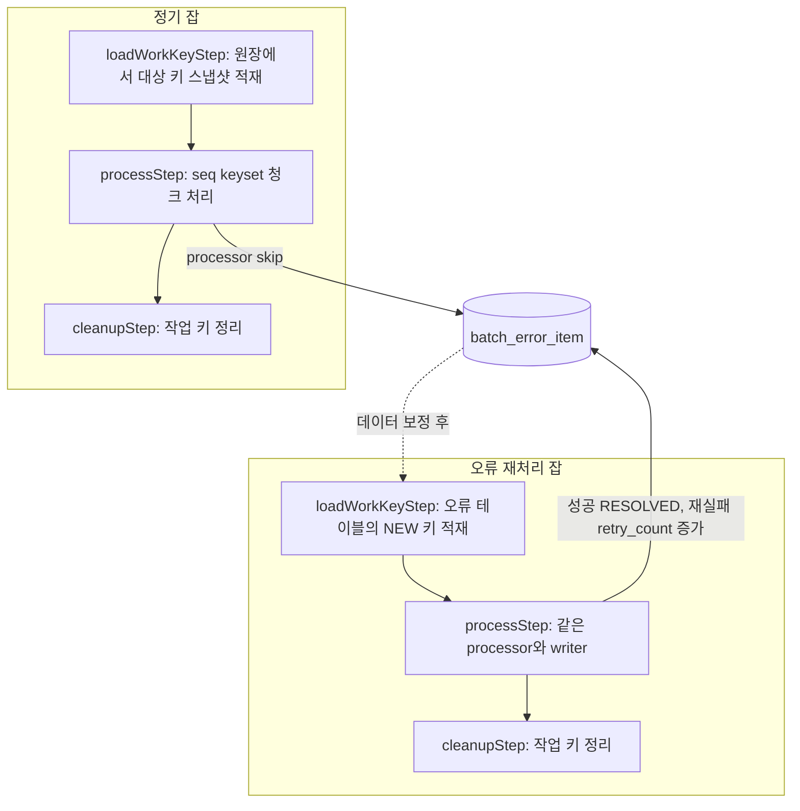

# Spring Batch 대용량 처리 구조의 재시작·오류 처리 설계 제안

> 실패한 청크부터 이어서 돌고, 데이터 오류건은 걸러서 따로 처리한다

- 작성일: 2026-10-09
- 상태: 제안 (결정 필요 사항 포함)
- 대상: Oracle 기반 Spring Batch 대용량 처리 잡 (청크 10,000건 이상)
- 기준 버전: Spring Batch 5.x. 6.x는 청크 스텝 구성 API가 바뀌었으므로 예시 코드를 버전에 맞게 조정해야 합니다.

## 목차

- [TL;DR](#tldr)
- [1. 배경](#1-배경)
- [2. 현행 설계의 재시작 문제점](#2-현행-설계의-재시작-문제점)
- [3. 재시작 대안 비교](#3-재시작-대안-비교)
- [4. 건별 오류 처리 방식](#4-건별-오류-처리-방식)
- [5. 단계별 skip 정책 비교](#5-단계별-skip-정책-비교)
- [6. 최종안](#6-최종안)
- [7. 구체적 구현 방안](#7-구체적-구현-방안)
- [8. 테스트 전략](#8-테스트-전략)
- [9. 결정 필요 사항과 리스크](#9-결정-필요-사항과-리스크)
- [10. 도입 순서](#10-도입-순서)

## TL;DR

- **현행 설계는 재시작 시 미처리 건을 누락할 위험이 있습니다.** 별도 커서 트랜잭션은 재시작 위치를 "읽은 건수"로만 복원할 수 있습니다. 원장을 상태값으로 필터링하면서 처리 중에 그 상태를 갱신하는 구조라면, 재시작 시 결과 집합이 이미 줄어 있어 건수만큼 건너뛰는 순간 미처리 건이 빠집니다.
- **최종안은 드라이빙(작업) 테이블 패턴입니다.** Step 1에서 처리 대상 키를 순번(seq)과 함께 작업 테이블에 스냅샷으로 적재하고, Step 2에서 `seq` 기준 keyset 방식으로 청크를 처리하며 마지막 seq를 ExecutionContext에 저장합니다. 커서 트랜잭션과 GTT가 필요 없어지고, 대상 집합이 고정되어 재시작 결과가 결정적이 됩니다.
- **건별 데이터 오류는 processor 한 곳에서 skip하고 오류 테이블에 기록합니다.** reader·writer 실패는 skip하지 않고 잡 실패 후 재시작으로 처리합니다. 오류건 재처리 잡은 같은 processor·writer를 재사용하고, 키 공급원만 원장에서 오류 테이블로 바꿉니다.
- **처리 순서 의존성이 없다는 전제는 확인했습니다.** 부분 반영 허용 여부, 정기 배치와의 중복 처리, 오류건 운영 주체는 아직 결정이 필요합니다.

## 1. 배경

### 1.1 현재 설계

- Oracle IN 절 건수 제약(1,000개)을 피하기 위해 GTT(Global Temporary Table)를 사용하고, `ON COMMIT DELETE ROWS`를 적용한다.
- GTT에는 키 컬럼 위주의 소량 데이터만 담는다.
- 나머지 데이터는 reader에서 GTT와 조인해 조회한다.
- 대용량 처리를 위해 트랜잭션을 둘로 분리한다.
  - **커서 트랜잭션**: 원장 테이블을 커서로 조회한다.
  - **청크 트랜잭션**: GTT insert와 청크 처리를 수행한다.
- 청크 단위는 10,000건 이상이다.
- reader는 청크 단위로 데이터를 조회해 버퍼에 담고, processor에는 1건씩 전달한다.
- writer는 Spring Batch 구조대로 청크 단위로 받는다.

### 1.2 요구사항

| ID | 요구사항 |
|---|---|
| R1 | 잡이 도중에 실패하면, 원인 해결 후 **실패한 청크부터** 이어서 처리한다. 이미 커밋된 건은 다시 처리하지 않고, 미처리 건은 누락하지 않는다. |
| R2 | 특정 데이터 때문에 실패한 건은 잡 전체를 멈추지 않고 걸러낸 뒤, 나중에 모아서 처리할 수 있어야 한다. |
| R3 | 청크 10,000건 이상의 대용량 처리 성능을 유지한다. |

## 2. 현행 설계의 재시작 문제점

### 2.1 재시작 위치를 건수로만 복원할 수 있다

커서 방식으로 재시작하려면 쿼리를 다시 실행한 뒤 이미 처리한 N건을 건너뛰어야 합니다. Spring Batch의 `JdbcCursorItemReader`도 재시작 시 `jumpToItem`으로 같은 일을 합니다.

이 방식은 **원장을 상태값으로 필터링하고 writer가 그 상태를 갱신하는 구조**에서 깨집니다.

1. 대상 조건이 `STATUS = 'READY'`이고, 1차 실행에서 30,000건을 처리해 `DONE`으로 갱신한 뒤 실패했다.
2. 재시작하면 커서 쿼리를 다시 실행한다. 이미 처리된 30,000건은 결과에 없다.
3. 저장된 건수(30,000)만큼 건너뛴다. 그 결과 **실제로는 미처리인 30,000건이 조용히 누락**된다.

ORDER BY가 없다면 실행마다 순서가 달라질 수 있어 건수 기반 복원은 더 불안정해집니다.

### 2.2 장시간 커서는 ORA-01555 위험이 있다

커서를 수 시간 열어둔 채 다른 트랜잭션(이 잡의 청크 트랜잭션 포함)이 같은 테이블을 갱신하고 커밋하면, 커서가 읽어야 할 undo가 재사용되어 `ORA-01555: snapshot too old`가 발생할 수 있습니다.

### 2.3 두 트랜잭션의 읽기 시점이 다르다

커서는 오픈 시점 SCN 기준으로 읽고, 청크 트랜잭션의 GTT 조인은 각 쿼리 실행 시점 기준으로 읽습니다. 같은 키라도 커서가 본 데이터와 조인으로 가져온 데이터가 다를 수 있습니다.

### 2.4 재시작 비용이 크다

재시작할 때마다 커서를 다시 열고 앞부분을 fetch하며 건너뛰어야 합니다. 대상이 수천만 건이면 재시작 자체가 오래 걸립니다.

## 3. 재시작 대안 비교

### 3.1 대안 0: 현행 유지 + 건수 기반 재시작

현재 구조 그대로 읽은 건수를 ExecutionContext에 저장하고, 재시작 시 그만큼 건너뜁니다. **필터 조건이 처리 결과로 바뀌지 않고, 실행 간 데이터가 변하지 않는다는 보장이 있을 때만** 안전합니다. 2장의 문제는 모두 남습니다.

### 3.2 대안 A: keyset 페이징 + GTT

커서 트랜잭션을 없애고, 청크 트랜잭션 하나 안에서 다음을 반복합니다.

1. `WHERE key > :lastKey ORDER BY key FETCH FIRST :n ROWS ONLY`로 다음 키 페이지를 조회한다.
2. 조회한 키를 GTT에 insert한다.
3. GTT와 조인해 나머지 데이터를 버퍼에 채운다.

reader가 `ItemStream`을 구현해 "processor로 넘긴 마지막 키"를 `update()`에서 저장하고, `open()`에서 복원합니다. GTT가 같은 세션·같은 트랜잭션 안에서만 쓰이므로 `ON COMMIT DELETE ROWS`와도 자연스럽게 맞습니다.

- 장점: 변경 범위가 작다. 건수가 아닌 키 기준이라 상태 필터 문제에서 자유롭다.
- 한계: 대상 집합이 고정되지 않는다. 실행 중이나 재시작 사이에 새로 유입된 건이 포함될 수 있다. 키 분포가 고르지 않으면 병렬화(파티셔닝)할 때 범위 분할이 어렵다.

### 3.3 대안 B: 드라이빙(작업) 테이블

- **Step 1**: 처리 대상 키를 일반 테이블에 순번(`seq`)과 함께 한 번에 적재한다 (`INSERT ... SELECT` 단일 문장).
- **Step 2**: `seq > :lastSeq` 기준으로 작업 테이블의 키 페이지를 읽고, 원장과 조인해 처리한다. 마지막 seq를 ExecutionContext에 저장한다.

Step 1은 단일 문장이므로 Oracle의 문장 수준 읽기 일관성으로 대상 집합이 한 시점에 고정됩니다. 재시작하면 완료된 Step 1은 다시 실행되지 않으므로 스냅샷이 그대로 유지됩니다.

### 3.4 비교

| 항목 | 대안 0: 현행 유지 | 대안 A: keyset + GTT | 대안 B: 드라이빙 테이블 |
|---|---|---|---|
| 재시작 기준 | 읽은 건수 | 마지막 키 | 마지막 seq |
| 상태 필터·갱신 시 누락 위험 | **있음** | 없음 | 없음 |
| 대상 집합 고정 | 안 됨 | 안 됨 (신규 유입 건 포함 가능) | **됨** (Step 1 시점 스냅샷) |
| 장시간 커서, ORA-01555 | 있음 | 없음 | 없음 |
| 트랜잭션 구조 | 2개 (커서 + 청크) | 1개 | 스텝별 1개 |
| 추가 DB 객체 | GTT | GTT | 작업 테이블 |
| redo 발생 | 적음 | 적음 | 키 적재·삭제분 발생 |
| 재시작 비용 | 앞부분 재 fetch | 거의 없음 | 거의 없음 |
| 병렬화(파티셔닝) | 어려움 | 키 범위 분할, 불균등 가능 | seq 범위로 균등 분할 |
| 오류건 재처리 연계 | 별도 구현 | 별도 구현 | 키 공급원만 바꿔 재사용 |
| 변경 범위 | 없음 | 작음 | 중간 |

### 3.5 판단

**대안 B를 채택합니다.** 요구사항 R1(누락·중복 없는 재시작)을 가장 결정적으로 만족하고, R2(오류건 재처리)와 R3(병렬화를 통한 성능 확장)까지 같은 구조로 풀 수 있기 때문입니다.

다음 조건이면 대안 A가 낫습니다.
- 작업 테이블 생성이 DBA 정책상 불가능하다.
- 키 적재·삭제로 인한 redo 증가를 허용할 수 없다.
- 실행 시점마다 최신 대상을 반영해야 하는 업무다.

## 4. 건별 오류 처리 방식

### 4.1 재시작과 skip의 역할 분리

재시작과 skip은 서로 다른 종류의 실패를 처리합니다. 둘 다 필요합니다.

| 구분 | 시스템성 실패 | 데이터성 실패 |
|---|---|---|
| 예 | DB 장애, 커넥션 끊김, 코드 버그 | 필수값 누락, 업무 규칙 위반 |
| 다시 시도하면 | 원인 해결 후 성공 | 데이터를 고치기 전까지 계속 실패 |
| 처리 | 잡 실패 → 원인 해결 → **재시작** | 해당 건 **skip** → 오류 테이블 기록 → 잡 계속 |
| 후속 조치 | 실패한 청크부터 이어서 처리 | 데이터 보정 후 오류건만 **재처리 잡**으로 처리 |

일시적 오류(데드락, 타임아웃)는 둘 다 아닌 경우로, 제한된 횟수만큼 **retry**합니다.

### 4.2 skip 적용 전제 조건

| 전제 | 내용 | 상태 |
|---|---|---|
| 처리 순서 의존성 없음 | 앞 건을 skip하고 뒤 건을 처리해도 결과가 틀어지지 않는다 (잔액 누적, 선후 거래 등이 없다) | **확인됨** |
| 부분 반영 허용 | 일부 건이 빠진 채 잡이 COMPLETED로 끝나도 후속 배치·정산이 문제없다 | 확인 필요 |
| 정기 배치와의 중복 | 재처리 전 다음 정기 배치가 같은 키를 다시 잡는지, 잡는다면 제외할지 | 결정 필요 |
| 운영 주체 | 오류 테이블 모니터링, 데이터 보정, 재처리 실행 담당 | 결정 필요 |

순서 의존성이 있는 업무였다면, 오류 키와 같은 그룹(계좌 등)의 후속 건을 함께 보류하거나 skip 없이 재시작 방식으로만 운영해야 합니다.

## 5. 단계별 skip 정책 비교

### 5.1 단계별 실패의 성격

| 단계 | 주요 실패 원인 | 성격 | 이 구조에서의 특이사항 |
|---|---|---|---|
| Reader | 페이지 조회(키 조회, 조인) 실패 | 대부분 시스템성 | 버퍼형 reader는 read skip 후 `read()`가 다시 호출되면 같은 조회를 재시도해 같은 예외가 반복된다 |
| Processor | 업무 검증 실패 | 데이터성 | 해당 건만 빠지고 롤백이 없어 비용이 가장 작다 |
| Writer | 제약 조건 위반, DB 오류 | 혼재 | skip 시 청크 전체 롤백 후 1건씩 다시 쓰는 scanning이 발생한다. 이 과정에서 processor도 다시 호출된다 |

### 5.2 대안 비교

Spring Batch의 `SkipPolicy`는 스텝 단위로 하나이고, `shouldSkip(Throwable, skipCount)`에는 실패 단계 정보가 없습니다. 그래서 단계별 정책은 **예외 타입으로 단계를 구분**해야 합니다.

| 항목 | 대안 a: 단계별 정책 | 대안 b: processor 집중 |
|---|---|---|
| 방식 | 단계별 예외 계층을 만들고, 커스텀 `SkipPolicy`에서 타입별 한도를 관리한다 | 데이터 검증을 processor로 모으고 processor 예외만 skip한다. reader·writer는 실패 후 재시작 |
| 버퍼형 reader 대응 | 행 단위 매핑 오류를 오류 마커로 버퍼에 넣고 해당 차례에 예외를 던지도록 별도 구현 필요 | 불필요. reader는 느슨하게 매핑만 한다 |
| write scanning 비용 | 발생 (10,000건을 1건씩 재처리) | 거의 발생하지 않음 |
| skip 카운터 | 커스텀 카운터는 메모리에만 있어 재시작 시 0으로 초기화. 별도 저장 필요 | 프레임워크 기본 skip 카운트 사용 |
| 테스트·운영 복잡도 | 높음 | 낮음 |

### 5.3 판단

**대안 b를 채택합니다.** 데이터 오류는 processor 한 곳으로 몰고, reader와 writer는 실패 후 재시작으로 처리합니다. writer에서 데이터 기인 예외가 실제로 반복 관측되면, 그때 해당 예외 타입만 skip 대상에 추가합니다.

## 6. 최종안



핵심 결정은 다음과 같습니다.

1. **재시작**: 드라이빙 테이블(`batch_work_key`) + `seq` keyset reader. 마지막으로 processor에 넘긴 seq를 ExecutionContext에 저장한다.
2. **트랜잭션**: 커서 트랜잭션을 없애고 청크 트랜잭션 하나로 처리한다. GTT도 쓰지 않는다.
3. **skip**: processor의 데이터 검증 예외만 skip한다. 일시적 DB 오류는 retry, 나머지는 실패 후 재시작한다.
4. **오류 기록**: SkipListener가 청크 트랜잭션 안에서 `batch_error_item`에 기록한다.
5. **재처리**: 같은 잡 구조에서 키 공급원만 오류 테이블로 바꾼 재처리 잡을 둔다.

## 7. 구체적 구현 방안

### 7.1 작업 테이블

```sql
CREATE TABLE batch_work_key (
    job_instance_id  NUMBER  NOT NULL,
    seq              NUMBER  NOT NULL,
    key_id           NUMBER  NOT NULL,   -- 원장 키. 복합키면 컬럼을 추가한다
    CONSTRAINT pk_batch_work_key PRIMARY KEY (job_instance_id, seq)
);
```

- 구분 키는 `JOB_EXECUTION_ID`가 아니라 **`JOB_INSTANCE_ID`**입니다. 재시작하면 JobExecution은 새로 생기지만 JobInstance는 같으므로, 스냅샷을 그대로 이어 쓸 수 있습니다.
- 데이터량이 크면 `job_instance_id` 기준 자동 리스트 파티션(Oracle 12.2+)을 검토합니다. 정리할 때 `DELETE` 대신 파티션 drop으로 끝낼 수 있어 redo와 시간이 크게 줄어듭니다.

### 7.2 Step 1: 대상 키 적재

Tasklet 하나로 구현하고, 같은 인스턴스의 잔여 데이터를 지운 뒤 적재합니다. Step 1 자체가 실패했다가 다시 돌아도 안전합니다.

```sql
DELETE FROM batch_work_key WHERE job_instance_id = :jobInstanceId;

INSERT INTO batch_work_key (job_instance_id, seq, key_id)
SELECT :jobInstanceId,
       ROW_NUMBER() OVER (ORDER BY l.ledger_id),
       l.ledger_id
  FROM ledger l
 WHERE l.status = 'READY';          -- 실제 대상 조건
```

- 대상이 매우 많으면 `/*+ APPEND */`로 direct-path insert를 고려합니다. 다만 테이블 단위 배타 락이 걸리므로, 이 테이블을 쓰는 다른 잡이 동시에 돌 수 있다면 사용하지 않습니다.
- **Step 1에 `allowStartIfComplete(true)`를 설정하지 않습니다.** 기본값(false)이어야 재시작 시 Step 1을 건너뛰고 스냅샷을 유지합니다.

### 7.3 Step 2: seq keyset reader

키 페이지를 먼저 자른 뒤 원장과 조인합니다. 원래 설계의 "키 조회 → GTT → 조인" 흐름을 작업 테이블로 옮긴 형태입니다. 원장 조인이 1:N이어도 페이지가 seq 중간에서 잘리지 않습니다.

```sql
WITH page AS (
    SELECT seq, key_id
      FROM batch_work_key
     WHERE job_instance_id = :jobInstanceId
       AND seq > :afterSeq
     ORDER BY seq
     FETCH FIRST :fetchSize ROWS ONLY
)
SELECT p.seq, l.*            -- 필요한 컬럼만 명시
  FROM page p
  JOIN ledger l ON l.ledger_id = p.key_id
 ORDER BY p.seq
```

`seq > :afterSeq AND seq <= :afterSeq + :n` 같은 범위 조건 대신 `FETCH FIRST`를 쓰는 이유는, 조인 결과가 비어 있는 seq가 있어도(원장 삭제 등) 빈 페이지를 "끝"으로 오인하지 않기 위해서입니다.

```java
public class WorkKeyItemReader implements ItemStreamReader<TargetItem> {

    private static final String LAST_SEQ = "workKey.lastSeq";

    private final NamedParameterJdbcTemplate jdbc;
    private final long jobInstanceId;
    private final int fetchSize;
    private final Deque<TargetItem> buffer = new ArrayDeque<>();
    private long lastReturnedSeq;

    @Override
    public void open(ExecutionContext ctx) {
        lastReturnedSeq = ctx.containsKey(LAST_SEQ) ? ctx.getLong(LAST_SEQ) : 0L;
        buffer.clear();
    }

    @Override
    public TargetItem read() {
        if (buffer.isEmpty()) {
            buffer.addAll(fetchNextPage(lastReturnedSeq));
        }
        TargetItem item = buffer.poll();
        if (item != null) {
            lastReturnedSeq = item.seq();
        }
        return item;   // null이면 스텝 종료
    }

    @Override
    public void update(ExecutionContext ctx) {   // 청크 커밋 직전, 같은 트랜잭션에서 호출됨
        ctx.putLong(LAST_SEQ, lastReturnedSeq);
    }

    private List<TargetItem> fetchNextPage(long afterSeq) {
        return jdbc.query(PAGE_SQL,
                Map.of("jobInstanceId", jobInstanceId, "afterSeq", afterSeq, "fetchSize", fetchSize),
                new TargetItemAggregatingExtractor());   // 1:N이면 seq 단위로 묶어 아이템 1개로 만든다
    }
}
```

구현 규칙은 다음과 같습니다.

- **저장하는 값은 "버퍼에 채운 마지막 seq"가 아니라 "read()로 반환한 마지막 seq"입니다.** 그래야 fetchSize와 commit-interval이 어긋나도 버퍼에 남은 미처리 건을 잃지 않습니다.
- **아이템 1개 = seq 1개**를 유지합니다. 조인이 1:N이면 `ResultSetExtractor`에서 seq 단위로 묶습니다.
- 빈 등록 시 반환 타입을 `ItemReader`가 아닌 구현 클래스로 지정해야 `@StepScope` 프록시에서도 `ItemStream`으로 자동 등록됩니다.

```java
@Bean
@StepScope
public WorkKeyItemReader workKeyItemReader(
        NamedParameterJdbcTemplate jdbc,
        @Value("#{stepExecution.jobExecution.jobInstance.instanceId}") Long jobInstanceId) {
    return new WorkKeyItemReader(jdbc, jobInstanceId, CHUNK_SIZE);
}
```

### 7.4 Step 2: 스텝 구성과 skip 정책

데이터 오류 전용 예외를 정의합니다.

```java
/** 데이터 자체의 문제로, 다시 시도해도 같은 결과가 나오는 오류. skip 대상이다. */
public class InvalidItemException extends RuntimeException {
    private final String errorCode;

    public InvalidItemException(String errorCode, String message) {
        super(message);
        this.errorCode = errorCode;
    }

    public String errorCode() { return errorCode; }
}
```

processor는 검증에 실패하면 이 예외를 던지고, **DB 쓰기 같은 부수 효과를 갖지 않습니다.** retry나 write 실패 시 processor가 다시 호출될 수 있기 때문입니다.

```java
@Bean
public Step processStep(JobRepository jobRepository, PlatformTransactionManager tx,
                        WorkKeyItemReader reader, TargetItemProcessor processor,
                        TargetItemWriter writer, ErrorRecordingSkipListener skipListener) {
    return new StepBuilder("processStep", jobRepository)
            .<TargetItem, Result>chunk(CHUNK_SIZE, tx)
            .reader(reader)
            .processor(processor)
            .writer(writer)
            .faultTolerant()
                .skip(InvalidItemException.class)
                .skipLimit(SKIP_LIMIT)                       // 9장 결정 필요
                .retry(TransientDataAccessException.class)
                .retryLimit(3)
            .listener(skipListener)
            .build();
}
```

- skip 대상 목록에 없는 예외는 모두 스텝 실패로 이어지고, 재시작 대상이 됩니다.
- `skipLimit`은 안전장치입니다. 코드 버그로 전 건이 검증에 실패하면 한도에 걸려 잡이 멈춥니다.
- writer 예외를 skip 대상에 추가하게 되면 `processorNonTransactional()`도 함께 검토합니다. scanning 중 processor 결과를 캐시해 재호출을 막습니다.

### 7.5 오류 테이블과 SkipListener

```sql
CREATE TABLE batch_error_item (
    error_id          NUMBER GENERATED ALWAYS AS IDENTITY PRIMARY KEY,
    job_name          VARCHAR2(100)  NOT NULL,
    job_instance_id   NUMBER         NOT NULL,
    job_execution_id  NUMBER         NOT NULL,
    step_name         VARCHAR2(100)  NOT NULL,
    phase             VARCHAR2(10)   NOT NULL,   -- READ / PROCESS / WRITE
    item_key          VARCHAR2(200)  NOT NULL,
    error_code        VARCHAR2(50),
    error_message     VARCHAR2(4000),
    status            VARCHAR2(10)   DEFAULT 'NEW' NOT NULL,   -- NEW / RESOLVED / FAILED
    retry_count       NUMBER(3)      DEFAULT 0 NOT NULL,
    created_at        TIMESTAMP      DEFAULT SYSTIMESTAMP NOT NULL,
    updated_at        TIMESTAMP
);

CREATE INDEX ix_batch_error_item_01 ON batch_error_item (job_name, status);
CREATE INDEX ix_batch_error_item_02 ON batch_error_item (job_name, item_key);
```

| 상태 | 의미 |
|---|---|
| NEW | 재처리 대기 |
| RESOLVED | 재처리 성공 |
| FAILED | 재처리 한도 초과. 수동 확인 대상 |

```java
public class ErrorRecordingSkipListener implements SkipListener<TargetItem, Result> {

    private final ErrorItemRepository errorItems;   // 업무와 같은 DataSource의 JdbcTemplate 사용
    private StepExecution stepExecution;

    @BeforeStep
    public void beforeStep(StepExecution stepExecution) {
        this.stepExecution = stepExecution;
    }

    @Override
    public void onSkipInProcess(TargetItem item, Throwable t) {
        errorItems.insert(ErrorItem.of(stepExecution, Phase.PROCESS, item.keyId(), t));
    }

    @Override
    public void onSkipInWrite(Result item, Throwable t) {
        errorItems.insert(ErrorItem.of(stepExecution, Phase.WRITE, item.keyId(), t));
    }
}
```

- SkipListener는 **청크 커밋 직전, 같은 트랜잭션 안에서** 호출됩니다. 청크가 롤백되면 오류 기록도 함께 롤백되므로 중복 기록이 생기지 않습니다. `REQUIRES_NEW`로 분리하지 않습니다.
- `error_message`는 4,000바이트를 넘지 않도록 잘라서 저장합니다.

### 7.6 트랜잭션과 JobRepository

- **JobRepository와 업무 테이블이 같은 DataSource, 같은 `PlatformTransactionManager`를 써야 합니다.** 그래야 업무 데이터 커밋과 ExecutionContext(마지막 seq) 저장이 원자적으로 함께 커밋됩니다.
- 메타 테이블이 다른 DB에 있다면, 업무 커밋 후 메타 저장 전에 장애가 나면 마지막 청크가 다시 처리됩니다. 이 경우를 대비해 **writer는 항상 멱등하게** 만듭니다. `MERGE`를 쓰거나, `WHERE status = 'READY'`처럼 조건부로 갱신합니다.
- **재시작은 같은 JobParameters로 실행하거나 `JobOperator.restart(executionId)`로 수행합니다.** `RunIdIncrementer` 등으로 실행마다 파라미터가 바뀌면 재시작이 아니라 새 인스턴스로 처음부터 실행되므로, 운영 실행 스크립트의 파라미터 구성을 확인합니다.

### 7.7 Step 3: 정리와 하우스키핑

- 잡이 성공하면 마지막 스텝에서 해당 `job_instance_id`의 작업 키를 삭제합니다 (파티션 적용 시 파티션 drop).
- 실패 후 재시작하지 않고 포기한(ABANDONED) 인스턴스의 작업 키는 남습니다. 주기적인 하우스키핑 잡으로 일정 기간이 지난 인스턴스의 키를 정리합니다.

### 7.8 오류건 재처리 잡

정기 잡과 같은 구조에서 **Step 1의 키 공급원만 오류 테이블로 바꿉니다.**

```sql
INSERT INTO batch_work_key (job_instance_id, seq, key_id)
SELECT :jobInstanceId,
       ROW_NUMBER() OVER (ORDER BY e.error_id),
       TO_NUMBER(e.item_key)
  FROM batch_error_item e
 WHERE e.job_name = :targetJobName
   AND e.status   = 'NEW';
```

Step 2는 같은 reader·processor를 쓰고, writer와 SkipListener만 재처리용으로 감쌉니다.

```java
public class ErrorResolvingItemWriter implements ItemWriter<Result> {

    private final ItemWriter<Result> delegate;      // 정기 잡과 같은 writer
    private final ErrorItemRepository errorItems;
    private final String targetJobName;

    @Override
    public void write(Chunk<? extends Result> chunk) throws Exception {
        delegate.write(chunk);
        // IN 절 대신 키 단위 batchUpdate (1,000건 제약 회피)
        errorItems.markResolved(targetJobName, chunk.getItems().stream().map(Result::keyId).toList());
    }
}
```

재처리 중 다시 skip된 건은 새 행을 만들지 않고 기존 행을 갱신합니다.

```sql
UPDATE batch_error_item
   SET retry_count   = retry_count + 1,
       status        = CASE WHEN retry_count + 1 >= :maxRetry THEN 'FAILED' ELSE 'NEW' END,
       error_code    = :errorCode,
       error_message = :errorMessage,
       updated_at    = SYSTIMESTAMP
 WHERE job_name = :targetJobName
   AND item_key = :itemKey
   AND status   = 'NEW';
```

- 재처리 잡의 JobParameters는 대상 잡 이름과 실행 시각으로 구성해 매번 새 인스턴스로 실행합니다.
- 재처리는 **데이터 보정이 끝난 뒤** 실행합니다. 보정 없이 돌리면 같은 오류가 반복되고 retry_count만 소진됩니다.

### 7.9 병렬화 확장 (선택)

`seq`가 1부터 연속으로 부여되므로 `Partitioner`가 전체 건수를 N등분해 `[minSeq, maxSeq]` 범위를 각 파티션의 ExecutionContext에 넣으면 됩니다. reader 쿼리에 `AND seq <= :maxSeq`만 추가하면 되고, 각 파티션이 자기 마지막 seq를 따로 저장하므로 재시작도 파티션 단위로 이어집니다. 단일 스레드 처리 성능을 측정한 뒤 필요할 때 적용합니다.

## 8. 테스트 전략

GTT, `FETCH FIRST`, direct-path insert, 파티션 등 Oracle 고유 동작이 핵심이므로 H2가 아니라 **Testcontainers Oracle(oracle-free)**로 통합 테스트를 작성합니다. `@SpringBatchTest`와 `JobLauncherTestUtils`(6.x는 `JobOperatorTestUtils`)를 사용합니다.

| # | 시나리오 | 기대 결과 |
|---|---|---|
| T1 | **현행 구조 회귀**: 상태 필터 + 상태 갱신 조건에서 N번째 청크 실패 후 재시작 | 현행 구조에서는 누락이 재현되어야 한다 (문제 입증용) |
| T2 | 신규 구조에서 같은 조건으로 실패 후 재시작 | 전 건이 정확히 1회 처리된다 (누락 0, 중복 0) |
| T3 | 재시작 사이에 원장에 신규 대상 건 추가 | 신규 건은 이번 인스턴스에 포함되지 않는다 (스냅샷 고정) |
| T4 | 검증 실패 데이터 k건 포함 | COMPLETED, skipCount = k, 오류 테이블 k건, 나머지 정상 처리 |
| T5 | 검증 실패 건수가 skipLimit 초과 | FAILED, 재시작 가능 |
| T6 | skip이 발생한 청크에서 writer 실패 주입 | 해당 청크의 업무 데이터와 오류 기록이 함께 롤백된다 |
| T7 | 재처리 잡: 보정된 건과 여전히 잘못된 건 혼재 | 보정 건은 RESOLVED, 나머지는 retry_count 증가, 한도 초과 시 FAILED |
| T8 | 1:N 조인에서 한 seq의 행이 페이지 경계에 걸침 | 아이템이 쪼개지지 않는다 |

T2의 형태는 다음과 같습니다.

```java
@Test
void 실패한_청크부터_재시작하면_누락과_중복이_없다() throws Exception {
    givenReadyTargets(35_000);                  // 청크 4개 (10,000 × 3 + 5,000)
    failureInjector.failOnChunk(3);             // 3번째 청크 write에서 실패

    JobExecution first = jobLauncherTestUtils.launchJob(params);
    assertThat(first.getStatus()).isEqualTo(BatchStatus.FAILED);
    assertThat(processedCount()).isEqualTo(20_000);

    failureInjector.disable();
    JobExecution second = jobLauncherTestUtils.launchJob(params);   // 같은 파라미터 = 재시작

    assertThat(second.getStatus()).isEqualTo(BatchStatus.COMPLETED);
    assertThat(processedCount()).isEqualTo(35_000);
    assertThat(processedMoreThanOnceCount()).isZero();
}
```

## 9. 결정 필요 사항과 리스크

| # | 항목 | 선택지 | 비고 |
|---|---|---|---|
| D1 | 부분 반영 허용 여부 | 허용 / 오류건 존재 시 후속 배치 차단 | 후속 배치·정산 담당자와 협의 |
| D2 | 정기 배치와 오류 키 중복 | 정기 Step 1에서 NEW 오류 키 제외 / 정기 배치가 자연 재시도 | 후자라면 재처리 잡은 긴급 처리용으로만 둔다 |
| D3 | skipLimit 값 | 절대 건수 / 대상 대비 비율 | 기존 장애 이력의 데이터 오류 비율을 근거로 정한다 |
| D4 | 재처리 최대 횟수 | 예: 3회 | 초과 시 FAILED, 수동 확인 |
| D5 | 오류 운영 주체 | 모니터링, 보정, 재처리 실행 담당 | 없으면 오류 테이블은 쌓이기만 한다 |
| D6 | 작업 테이블 운영 | 파티션 적용 여부, APPEND 사용 여부, 하우스키핑 주기 | DBA 협의 |
| D7 | JobRepository DataSource | 업무 DB와 동일 / 분리 | 분리 시 writer 멱등성 필수 |

| 리스크 | 영향 | 대응 |
|---|---|---|
| 작업 테이블 적재·삭제 redo 증가 | 아카이브 로그 증가 | 파티션 drop, APPEND 검토 |
| 청크 10,000건의 롤백 비용 | 실패 시 재처리량과 롤백 시간 증가 | 처리량과 롤백 시간을 함께 측정해 크기 조정 |
| 데이터 오류가 writer에서 발생 | write scanning으로 성능 저하 | processor 검증 보강, 필요한 예외만 write skip 추가 |
| 실행 파라미터 구성 오류 | 재시작 대신 처음부터 재실행 | 운영 스크립트에서 재시작 경로 분리 |

## 10. 도입 순서

1. **문제 재현 테스트 작성 (T1)**: 현행 구조에서 재시작 누락을 테스트로 입증한다. 변경 필요성의 근거가 된다.
2. **작업 테이블 + seq reader 도입**: Step 1, Step 2 reader, Step 3을 구현하고 T2, T3, T8을 통과시킨다.
3. **skip 정책 + 오류 테이블 도입**: 예외 계층, SkipListener를 구현하고 T4~T6을 통과시킨다.
4. **재처리 잡 도입**: T7을 통과시킨다. D2 결정에 따라 정기 Step 1의 대상 조건을 조정한다.
5. **성능 측정과 튜닝**: 운영 규모 데이터로 청크 크기, APPEND, 파티셔닝 적용 여부를 결정한다.
